# ĐẠI HỌC PHENIKAA — TRƯỜNG CÔNG NGHỆ THÔNG TIN PHENIKAA
## BÁO CÁO ĐỒ ÁN: ĐÁNH GIÁ VÀ KIỂM ĐỊNH CHẤT LƯỢNG PHẦN MỀM
# XÂY DỰNG CÔNG CỤ TỰ ĐỘNG KIỂM THỬ HỒI QUY GIAO DIỆN TRỰC QUAN CHO ỨNG DỤNG WEB (AUTOMATED VISUAL REGRESSION TESTING TOOL)

- **Học phần:** Đánh giá và Kiểm định Chất lượng Phần mềm (Software Testing & QA)
- **Kho mã nguồn GitHub:** `https://github.com/mchienc/software-testing.git`
- **Ngăn xếp công nghệ:** Python 3.10+, FastAPI, Playwright Headless Chromium, OpenCV, scikit-image (SSIM), React 19 (Vite), Tailwind CSS, GitHub Actions CI/CD
- **Địa điểm & Thời gian:** Hà Nội, năm 2026


---


# LỜI CẢM ƠN

Trước hết, em xin gửi lời cảm ơn chân thành và sâu sắc nhất tới Quý Thầy/Cô giảng viên Khoa Công nghệ Thông tin – Trường Công nghệ Thông tin Phenikaa, Đại học Phenikaa đã tận tình giảng dạy, truyền đạt những kiến thức nền tảng và chuyên sâu về Công nghệ Phần mềm cũng như học phần Đánh giá và Kiểm định Chất lượng Phần mềm.

Trong suốt quá trình nghiên cứu và thực hiện đề tài “Xây dựng Công cụ Tự động Kiểm thử Hồi quy Giao diện Trực quan cho Ứng dụng Web (Automated Visual Regression Testing Tool)”, em đã có cơ hội vận dụng trực tiếp các lý thuyết kiểm thử hộp đen (Black-box Testing), kiểm thử hồi quy tự động (Automated Regression Testing), kiểm soát chất lượng trong đường ống tích hợp liên tục (CI/CD Quality Gate) kết hợp cùng các giải thuật Thị giác máy tính (Computer Vision). Dù đã nỗ lực hoàn thiện hệ thống từ lõi thuật toán đến giao diện bàn kiểm định và tích hợp đám mây GitHub Actions, báo cáo khó tránh khỏi những thiếu sót nhất định. Em rất mong nhận được những ý kiến đóng góp quý báu từ Quý Thầy/Cô để hệ thống ngày càng hoàn thiện hơn.

**Em xin chân thành cảm ơn!**


---


# LỜI CAM ĐOAN

Em xin cam đoan toàn bộ nội dung nghiên cứu, phân tích thiết kế hệ thống, mã nguồn chương trình và kết quả thực nghiệm trình bày trong báo cáo đồ án “Xây dựng Công cụ Tự động Kiểm thử Hồi quy Giao diện Trực quan cho Ứng dụng Web” là kết quả làm việc nghiêm túc, trung thực của bản thân dưới sự hướng dẫn của giảng viên phụ trách học phần.

Các số liệu đo lường tỷ lệ sai lệch điểm ảnh (Diff Ratio %), chỉ số tương đồng cấu trúc (SSIM), tọa độ vùng lỗi (Bounding Boxes) và lịch sử thực thi trên GitHub Actions đều được trích xuất trực tiếp từ hệ thống thực tế. Mọi tài liệu tham khảo, bài báo khoa học và thư viện mã nguồn mở sử dụng trong đồ án đều được trích dẫn rõ ràng ở phần cuối báo cáo.

**Em xin hoàn toàn chịu trách nhiệm trước Nhà trường và pháp luật về tính trung thực, chính xác của các nội dung được trình bày trong báo cáo đồ án này.**


---


# MỤC LỤC

- **LỜI CẢM ƠN** *(Trang 2)*
- **LỜI CAM ĐOAN** *(Trang 3)*
- **MỤC LỤC** *(Trang 4)*
- **DANH MỤC HÌNH ẢNH** *(Trang 6)*
- **DANH MỤC BẢNG BIỂU** *(Trang 8)*
- **CHƯƠNG 1: TỔNG QUAN ĐỀ TÀI & CƠ SỞ LÝ THUYẾT KIỂM THỬ HỒI QUY GIAO DIỆN** *(Trang 10)*
  - 1.1 Đặt Vấn Đề (Problem Statement) *(Trang 10)*
    - 1.1.1 Bối Cảnh Thực Tiễn Trong Kiểm Thử Phần Mềm Hiện Đại *(Trang 10)*
    - 1.1.2 Mô Tả Hệ Thống Đề Xuất (Automated Visual Regression Testing Tool) *(Trang 11)*
    - 1.1.3 Mục Tiêu Đề Tài *(Trang 11)*
    - 1.1.4 Đối Tượng Người Dùng Mục Tiêu *(Trang 12)*
    - 1.1.5 Lợi Ích Khi Sử Dụng Phần Mềm *(Trang 12)*
    - 1.1.6 Phạm Vi Của Dự Án *(Trang 13)*
  - 1.2 Cơ Sở Lý Thuyết Kiểm Thử Phần Mềm & Thị Giác Máy Tính *(Trang 13)*
    - 1.2.1 So Sánh Kiểm Thử Hồi Quy Giao Diện và Kiểm Thử Chức Năng Truyền Thống *(Trang 13)*
    - 1.2.2 Bài Toán Sai Số Loại I (False Positives) & Sai Số Loại II (False Negatives) *(Trang 14)*
    - 1.2.3 Giải Thuật So Khớp Điểm Ảnh Tri Giác (Perceptual Color Distance ΔE) *(Trang 14)*
    - 1.2.4 Bộ Lọc Khử Răng Cưa Chữ 3×3 (Anti-Aliasing Detection Filter) *(Trang 15)*
    - 1.2.5 Chỉ Số Tương Đồng Cấu Trúc (SSIM — Structural Similarity Index) *(Trang 15)*
    - 1.2.6 Gom Cụm Hình Thái Học & Khoanh Vùng Khiếm Khuyết (OpenCV Bounding Boxes) *(Trang 16)*
  - 1.3 Thuật Ngữ Chuyên Ngành (Glossary) *(Trang 16)*
  - 1.4 Thông Số Kỹ Thuật Bổ Sung (Supplementary Specifications) *(Trang 17)*
    - 1.4.1 Yêu Cầu Về Hiệu Năng (Performance) *(Trang 17)*
    - 1.4.2 Yêu Cầu Về Độ Tin Cậy & Chính Xác (Reliability & Accuracy) *(Trang 17)*
    - 1.4.3 Yêu Cầu Về Khả Dụng (Usability) *(Trang 18)*
  - 1.5 Mô Hình Hóa Quy Trình Nghiệp Vụ Kiểm Thử *(Trang 18)*
  - 1.6 Sơ Lược Về UML & Các Biểu Đồ Sử Dụng Trong Báo Cáo *(Trang 18)*
  - 1.7 Công Nghệ Sử Dụng *(Trang 19)*
- **CHƯƠNG 2: PHÂN TÍCH VÀ THIẾT KẾ HỆ THỐNG** *(Trang 20)*
  - 2.1 Sơ Đồ Use Case (Use Case Modeling) *(Trang 20)*
    - 2.1.1 Tổng Hợp Các Nhóm Chức Năng *(Trang 20)*
    - 2.1.2 Bảng Ánh Xạ Chức Năng Với Các Use Case (UC01 – UC18) *(Trang 21)*
    - 2.1.3 Đặc Tả Chi Tiết Các Use Case (UC01 – UC18) *(Trang 22)*
  - 2.2 Các Biểu Đồ Phân Tích Hệ Thống (Activity & Sequence Diagrams) *(Trang 29)*
    - 2.2.1 Phân Tích Luồng Hoạt Động (Activity Diagrams 2.2.1.1 – 2.2.1.10) *(Trang 29)*
    - 2.2.2 Phân Tích Trình Tự Tương Tác (Sequence Diagrams 2.2.2.1 – 2.2.2.10) *(Trang 34)*
  - 2.3 Thiết Kế Kiến Trúc 3 Lớp (Three-Tier Architecture) *(Trang 39)*
    - 2.3.1 Lớp Trình Bày (Presentation Layer) *(Trang 39)*
    - 2.3.2 Lớp Xử Lý Nghiệp Vụ & Thị Giác Máy Tính (Business Logic Layer) *(Trang 40)*
    - 2.3.3 Lớp Lưu Trữ Dữ Liệu (Data & Artifact Storage Layer) *(Trang 40)*
  - 2.4 Thiết Kế Cấu Trúc Dữ Liệu & Lược Đồ Thực Thể (Data Schema) *(Trang 41)*
    - 2.4.1 Cấu Trúc Thực Thể Bộ Kịch Bản Kiểm Thử (TestSuite Schema) *(Trang 41)*
    - 2.4.2 Cấu Trúc Thực Thể Phiên Chạy Kiểm Thử (TestRun & ViewportResult Schema) *(Trang 42)*
    - 2.4.3 Cấu Trúc Thực Thể Vùng Khiếm Khuyết Giao Diện (BoundingBox Schema) *(Trang 42)*
- **CHƯƠNG 3: XÂY DỰNG HỆ THỐNG, GIAO DIỆN & THỰC NGHIỆM KIỂM THỬ** *(Trang 43)*
  - 3.1 Kiến Trúc Mã Nguồn & Tổ Chức Thư Mục *(Trang 43)*
  - 3.2 Hiện Thực Hóa Các Thuật Toán Lõi (Core Engine Implementation) *(Trang 44)*
    - 3.2.1 Module Chụp Ảnh Đa Màn Hình & Khử Nhiễu (browser_engine.py) *(Trang 44)*
    - 3.2.2 Module Thị Giác Máy Tính & Khoanh Vùng Lỗi (diff_engine.py) *(Trang 44)*
    - 3.2.3 Module Kiểm Thử Trực Tiếp Kho Mã Nguồn GitHub (github_runner.py) *(Trang 45)*
  - 3.3 Các Giao Diện Chính Của Hệ Thống (Web Dashboard 3 Tab) *(Trang 45)*
    - 3.3.1 Giao Diện Tab 01 — Bàn Kiểm Định & So Khớp Điểm Ảnh (Chế Độ Tối & Sáng) *(Trang 45)*
    - 3.3.2 Giao Diện Tab 02 — Biểu Đồ Xu Hướng Chất Lượng & Nhật Ký Lịch Sử *(Trang 47)*
    - 3.3.3 Giao Diện Tab 03 — Trung Tâm Tích Hợp CLI & CI/CD GitHub Actions *(Trang 47)*
  - 3.4 Thực Nghiệm Kiểm Thử Hệ Thống & Phân Tích Kết Quả *(Trang 48)*
    - 3.4.1 Kịch Bản Thực Nghiệm 1: Kiểm Chứng Khử Báo Động Giả (Zero-Diff: v1.0 vs v1.0) *(Trang 48)*
    - 3.4.2 Kịch Bản Thực Nghiệm 2: Phát Hiện Lỗi Hồi Quy Đa Màn Hình (v1.0 vs v2.0) *(Trang 48)*
    - 3.4.3 Bộ 25 Kịch Bản Kiểm Thử Hệ Thống (System Test Cases Specification) *(Trang 50)*
  - 3.5 Đặc Tả Các Điểm Cuối Giao Tiếp REST API (API Reference) *(Trang 51)*
- **CHƯƠNG 4: KẾT LUẬN VÀ HƯỚNG PHÁT TRIỂN** *(Trang 52)*
  - 4.1 Kết Quả Đạt Được *(Trang 52)*
    - 4.1.1 Về Mặt Chức Năng Hệ Thống *(Trang 52)*
    - 4.1.2 Về Mặt Kỹ Thuật & Học Thuật Kiểm Thử *(Trang 52)*
  - 4.2 Hạn Chế Của Hệ Thống Hiện Tại *(Trang 53)*
  - 4.3 Hướng Phát Triển Tương Lai *(Trang 53)*
    - 4.3.1 Ngắn hạn (1 – 3 tháng) *(Trang 53)*
    - 4.3.2 Trung hạn (3 – 6 tháng) *(Trang 53)*
    - 4.3.3 Dài hạn (Trên 6 tháng) *(Trang 53)*
  - 4.4 Kết Luận Chung *(Trang 54)*
  - TÀI LIỆU THAM KHẢO *(Trang 54)*

---


# DANH MỤC HÌNH ẢNH

  - Hình 1.1: Lưu đồ 5 bước của thuật toán So khớp Điểm ảnh & Thị giác máy tính *(Trang 16)*
  - Hình 2.1: Sơ đồ tổng quan Use Case của Công cụ Tự động Kiểm thử Hồi quy Giao diện *(Trang 20)*
  - Hình 2.1.1: Biểu đồ hoạt động — Chụp bộ ảnh chuẩn gốc (Capture Baseline) *(Trang 30)*
  - Hình 2.1.2: Biểu đồ hoạt động — Thực thi Phiên kiểm thử so khớp (Run Visual Test) *(Trang 30)*
  - Hình 2.1.3: Biểu đồ hoạt động — Chuẩn hóa kích thước ảnh (Canvas Auto-Padding) *(Trang 31)*
  - Hình 2.1.4: Biểu đồ hoạt động — Tính Perceptual Diff & Lọc răng cưa 3×3 *(Trang 31)*
  - Hình 2.1.5: Biểu đồ hoạt động — Gom cụm vùng lỗi OpenCV & Chẩn đoán ngữ nghĩa *(Trang 32)*
  - Hình 2.1.6: Biểu đồ hoạt động — Đối chiếu trực quan 5 chế độ trên Bàn Kiểm Định *(Trang 32)*
  - Hình 2.1.7: Biểu đồ hoạt động — Phê duyệt ảnh hiện tại làm Baseline mới *(Trang 33)*
  - Hình 2.1.8: Biểu đồ hoạt động — Kiểm thử trực tiếp kho mã nguồn GitHub *(Trang 33)*
  - Hình 2.1.9: Biểu đồ hoạt động — Cổng kiểm duyệt dòng lệnh Headless CLI *(Trang 34)*
  - Hình 2.1.10: Biểu đồ hoạt động — Đường ống tự động GitHub Actions CI/CD *(Trang 34)*
  - Hình 2.2.1: Biểu đồ tuần tự — SD01: Tạo Suite & Chụp Baseline *(Trang 35)*
  - Hình 2.2.2: Biểu đồ tuần tự — SD02: Chạy Phiên Kiểm Thử So Khớp *(Trang 35)*
  - Hình 2.2.3: Biểu đồ tuần tự — SD03: Phân Tích Điểm Ảnh Trong DiffEngine *(Trang 36)*
  - Hình 2.2.4: Biểu đồ tuần tự — SD04: Tương Tác Kính Lúp & Thanh Trượt *(Trang 36)*
  - Hình 2.2.5: Biểu đồ tuần tự — SD05: Phê Duyệt Ảnh Mới Làm Baseline *(Trang 37)*
  - Hình 2.2.6: Biểu đồ tuần tự — SD06: Truy Vấn Biểu Đồ Xu Hướng & Lọc Lịch Sử *(Trang 37)*
  - Hình 2.2.7: Biểu đồ tuần tự — SD07: Xuất Báo Cáo HTML Độc Lập Base64 *(Trang 38)*
  - Hình 2.2.8: Biểu đồ tuần tự — SD08: Đồng Bộ Trạng Thái GitHub Actions *(Trang 38)*
  - Hình 2.2.9: Biểu đồ tuần tự — SD09: Clone & Kiểm Thử Kho GitHub Bất Kỳ *(Trang 38)*
  - Hình 2.2.10: Biểu đồ tuần tự — SD10: Cổng Kiểm Duyệt Dòng Lệnh CLI *(Trang 39)*
  - Hình 2.2: Sơ đồ Kiến trúc 3 Lớp (Three-Tier Architecture) của hệ thống *(Trang 39)*
  - Hình 2.3: Lược đồ quan hệ dữ liệu giữa TestSuite, TestRun, ViewportResult và BoundingBox *(Trang 41)*
  - Hình 3.1: Giao diện Tab 01 — Bàn Kiểm Định & So Khớp Điểm Ảnh ở chế độ Tối (Dark Mode) *(Trang 46)*
  - Hình 3.2: Giao diện Tab 01 — Bàn Kiểm Định & So Khớp Điểm Ảnh ở chế độ Sáng (Light Mode) *(Trang 46)*
  - Hình 3.3: Giao diện Tab 02 — Biểu đồ Xu hướng Chất lượng và Bảng Nhật ký Lịch sử *(Trang 47)*
  - Hình 3.4: Giao diện Tab 03 — Trung tâm Tích hợp CLI & Kiểm thử Trực tiếp Kho GitHub *(Trang 48)*
  - Hình 3.5: Ảnh chụp màn hình Bản Chuẩn Gốc (Baseline Desktop 1920×1080) *(Trang 49)*
  - Hình 3.6: Ảnh chụp màn hình Bản Hiện Tại (Current Desktop) chứa lỗi hồi quy CSS *(Trang 49)*
  - Hình 3.7: Bản đồ nhiệt vùng lỗi (Diff Heatmap #FF0055) trên màn hình Desktop *(Trang 50)*

---


# DANH MỤC BẢNG BIỂU

  - Bảng 1.1: Các phân hệ cốt lõi của Công cụ Tự động Kiểm thử Hồi quy Giao diện *(Trang 11)*
  - Bảng 1.2: Phân tích các nhóm người dùng mục tiêu của hệ thống *(Trang 12)*
  - Bảng 1.3: So sánh giữa Kiểm thử chức năng DOM và Kiểm thử hồi quy giao diện *(Trang 13)*
  - Bảng 1.4: Phân tích Sai số Loại I và Sai số Loại II trong kiểm thử hồi quy giao diện *(Trang 14)*
  - Bảng 1.5: Bảng giải thích các thuật ngữ chuyên ngành sử dụng trong báo cáo *(Trang 16)*
  - Bảng 1.6: Các loại biểu đồ thiết kế sử dụng trong báo cáo *(Trang 18)*
  - Bảng 1.7: Ngăn xếp công nghệ (Tech Stack) sử dụng trong hệ thống *(Trang 19)*
  - Bảng 2.1: Bảng ánh xạ 18 Use Cases với các Module và REST API trong hệ thống *(Trang 21)*
  - Bảng đặc tả UC01 – UC18: Đặc tả chi tiết 18 Use Cases của hệ thống *(Trang 22)*
  - Bảng 2.2: Đặc tả 10 luồng hoạt động (Activity Workflows) cốt lõi của hệ thống *(Trang 29)*
  - Bảng 2.3: Đặc tả 10 biểu đồ tuần tự (Sequence Diagrams) của hệ thống *(Trang 34)*
  - Bảng 2.4: Các thành phần thuộc Lớp Trình Bày (Presentation Layer) *(Trang 39)*
  - Bảng 2.5: Các thành phần thuộc Lớp Xử Lý Nghiệp Vụ (Business Logic Layer) *(Trang 40)*
  - Bảng 2.6: Các thành phần thuộc Lớp Lưu Trữ Dữ Liệu (Storage Layer) *(Trang 40)*
  - Bảng 2.7: Đặc tả cấu trúc dữ liệu thực thể TestSuite *(Trang 41)*
  - Bảng 2.8: Đặc tả cấu trúc dữ liệu thực thể TestRun và ViewportResult *(Trang 42)*
  - Bảng 2.9: Đặc tả cấu trúc dữ liệu thực thể vùng lỗi BoundingBox *(Trang 42)*
  - Bảng 3.1: Kết quả thực nghiệm Kịch bản 1 — Kiểm chứng Zero-Diff (0% báo động giả) *(Trang 48)*
  - Bảng 3.2: Kết quả thực nghiệm Kịch bản 2 — Phát hiện lỗi hồi quy (v1.0 vs v2.0) *(Trang 49)*
  - Bảng 3.3: Bảng tổng hợp 25 Test Cases kiểm định toàn diện hệ thống *(Trang 50)*
  - Bảng 3.4: Danh mục đầy đủ các REST API Endpoints của hệ thống *(Trang 51)*
  - Bảng 4.1: Tổng kết các kết quả kỹ thuật đạt được của đồ án *(Trang 52)*

---


# CHƯƠNG 1: TỔNG QUAN ĐỀ TÀI & CƠ SỞ LÝ THUYẾT KIỂM THỬ HỒI QUY GIAO DIỆN


## 1.1 Đặt Vấn Đề (Problem Statement)


### 1.1.1 Bối Cảnh Thực Tiễn Trong Kiểm Thử Phần Mềm Hiện Đại

Trong kỷ nguyên phát triển phần mềm theo mô hình Agile và Tích hợp liên tục / Triển khai liên tục (CI/CD), tần suất cập nhật mã nguồn giao diện người dùng (HTML5, CSS3, JavaScript, React/Vue/Next.js) diễn ra hàng chục lần mỗi ngày. Một thay đổi nhỏ trong tập tin định kiểu CSS toàn cục, việc nâng cấp phiên bản thư viện giao diện, hoặc chỉnh sửa cấu trúc thẻ DOM ở một thành phần dùng chung đều có nguy cơ gây ra lỗi hồi quy giao diện (Visual Regression Bugs) ở những trang không ngờ tới.

Các dạng lỗi hồi quy giao diện phổ biến nhất trong thực tế doanh nghiệp bao gồm:

- Xô lệch bố cục (Layout Shift): Phần tử nút bấm, thanh điều hướng hoặc khối nội dung bị đẩy lệch hàng chục pixel do thay đổi thuộc tính margin, padding, flexbox hoặc grid.
- Sai lệch màu sắc nhận diện thương hiệu (Color & Contrast Regression): Nút kêu gọi hành động (CTA), huy hiệu trạng thái hoặc văn bản bị ghi đè biến CSS làm đổi màu ngoài ý muốn.
- Tràn khung và cắt cụt nội dung (Overflow & Clipping): Văn bản dài bị tràn ra ngoài khung chứa hoặc bị che khuất trên các thiết bị có màn hình nhỏ như máy tính bảng (Tablet) và điện thoại di động (Mobile).
- Mất tính tương thích đa thiết bị (Responsive Breakpoint Failure): Giao diện hiển thị hoàn hảo trên màn hình Desktop (1920×1080) nhưng lại bị chồng lấn nghiêm trọng trên màn hình Mobile (375×812).

Tuy nhiên, các phương pháp kiểm thử chức năng tự động truyền thống (Functional UI Automation sử dụng Selenium, Cypress hoặc Playwright Assertions thông thường) chỉ kiểm tra xem phần tử có tồn tại trong cây DOM hay không (ví dụ: expect(button).toBeVisible() hoặc assert button.text == 'Mua ngay'). Khi một nút bấm bị đổi màu sang tím, bị lệch xuống dưới 25 pixel đè lên đoạn văn bản khác, các bài kiểm thử chức năng vẫn báo ĐẠT (PASSED) 100%. Ngược lại, nếu giao cho kiểm thử viên (Manual Tester) ngồi dò bằng mắt thường hàng chục trang web trên 3 kích thước màn hình sau mỗi lần lập trình viên đẩy code (git push), chi phí thời gian là quá lớn và con người rất dễ bỏ sót các sai lệch nhỏ.


### 1.1.2 Mô Tả Hệ Thống Đề Xuất (Automated Visual Regression Testing Tool)

Để giải quyết triệt để khoảng trống giữa Kiểm thử chức năng DOM và Kiểm thử thủ công bằng mắt thường, đồ án xây dựng hệ thống “Công cụ Tự động Kiểm thử Hồi quy Giao diện Trực quan cho Ứng dụng Web” (tên định danh kỹ thuật: PixelPulse Visual QA Workbench). Hệ thống kết hợp trình duyệt không giao diện (Playwright Headless Chromium) với các giải thuật Thị giác máy tính (OpenCV, Perceptual Diff, SSIM) và Cổng kiểm duyệt tự động CI/CD (Headless CLI & GitHub Actions).


| Thành phần hệ thống | Mô tả chức năng cốt lõi |
| --- | --- |
| 1. Bộ chụp ảnh đa màn hình & Khử nhiễu (BrowserEngine) | Tự động điều khiển trình duyệt Chromium chụp ảnh toàn trang (Full-page Screenshot) đồng thời trên 3 độ phân giải chuẩn: Desktop (1920×1080), Tablet (768×1024) và Mobile (375×812). Tự động tiêm CSS khóa mọi hiệu ứng chuyển động (animation/transition), chờ phông chữ tải xong và che các vùng dữ liệu động (DOM Masking như đồng hồ .timestamp, bộ đếm truy cập). |
| 2. Lõi Thị giác máy tính & Chẩn đoán ngữ nghĩa (DiffEngine) | Chuẩn hóa kích thước ảnh tự động (Auto-Padding Canvas), tính khoảng cách màu sắc tri giác (Perceptual Diff ΔE), lọc bỏ nhiễu làm mịn chữ 3×3 (Anti-Aliasing Filter), đo chỉ số tương đồng cấu trúc SSIM, dùng phép toán hình thái học OpenCV gom cụm các điểm lỗi thành các khung chữ nhật (Bounding Boxes) và tự động sinh câu chẩn đoán lỗi bằng tiếng Việt. |
| 3. Bàn Kiểm Định Trực Quan 3 Tab (React 19 Workbench) | Cung cấp không gian làm việc mật độ cao hỗ trợ 5 chế độ soi lỗi quang học (Thanh trượt, 3 Cột song song, Chớp tắt, Mờ đè lớp, Kính lúp phóng đại 2x–4x), biểu đồ xu hướng chất lượng qua các phiên chạy, nhật ký lịch sử có bộ lọc và xuất báo cáo HTML độc lập / In PDF A4. |
| 4. Bộ kiểm thử trực tiếp kho GitHub & Cổng CI/CD (GitHubRunner & CLI) | Cung cấp công cụ dòng lệnh cli.py trả về mã thoát chuẩn (Exit Code 0/1/2), tích hợp sẵn GitHub Actions (.github/workflows/visual-regression.yml) và cho phép nhập bất kỳ link kho mã nguồn GitHub nào để hệ thống tự động git clone, dựng giao diện cục bộ và so sánh giữa 2 bản Commit hoặc giả lập lỗi CSS hồi quy. |

*Bảng 1.1: Các phân hệ cốt lõi của Công cụ Tự động Kiểm thử Hồi quy Giao diện*


### 1.1.3 Mục Tiêu Đề Tài

**Mục tiêu chức năng (Functional Objectives):**

- Xây dựng quy trình kiểm thử hồi quy giao diện chuẩn công nghiệp gồm 3 bước tách biệt: Chụp ảnh chuẩn gốc (Capture Baseline) → Chạy kiểm thử so khớp (Run Visual Diff) → Phê duyệt cập nhật chuẩn mới (Approve Baseline).
- Hỗ trợ kiểm thử đồng thời trên 3 độ phân giải thiết bị (Desktop, Tablet, Mobile) trong một phiên chạy duy nhất.
- Định vị chính xác tọa độ [X, Y, Rộng, Cao] của từng vùng giao diện bị biến dạng và phân loại mức độ nghiêm trọng (Nghiêm trọng / Trung bình / Thấp).
- Hỗ trợ đối chiếu trực quan bằng 5 chế độ tương tác chuyên sâu và xuất báo cáo HTML độc lập (nhúng sẵn ảnh Base64 không phụ thuộc máy chủ).
- Cung cấp công cụ dòng lệnh Headless CLI và tích hợp trực tiếp với GitHub Actions CI/CD cũng như kiểm thử trực tiếp từ đường dẫn kho mã nguồn GitHub.

**Mục tiêu phi chức năng (Non-Functional Objectives):**

- Độ chính xác cao (Zero False Positives): Triệt tiêu hoàn toàn báo động giả (Diff Ratio = 0.0000%, SSIM = 1.0000) khi kiểm thử hai phiên bản giao diện giống nhau có chứa phần tử thời gian thực.
- Hiệu năng xử lý nhanh: Thời gian phân tích thị giác máy tính cho mỗi độ phân giải màn hình dưới 1.5 giây; tổng thời gian chụp và kiểm định 3 màn hình từ 5 đến 12 giây.
- Giao diện chuẩn công nghiệp: Tuân thủ hệ thống thiết kế Swiss Data-Dense Workbench, hỗ trợ đầy đủ tiếng Việt, chuyển đổi chế độ Sáng / Tối (Light / Dark Mode) và tương thích in ấn chuẩn A4.


### 1.1.4 Đối Tượng Người Dùng Mục Tiêu


| Nhóm người dùng | Vai trò trong dự án | Nhu cầu sử dụng công cụ |
| --- | --- | --- |
| Kỹ sư Kiểm thử (QA / QC Engineer) | Người chịu trách nhiệm đảm bảo chất lượng giao diện trước khi phát hành | Thiết lập bộ ảnh chuẩn Baseline, kích hoạt phiên kiểm thử đa màn hình, soi kính lúp/thanh trượt để nghiệm thu giao diện và xuất báo cáo lỗi HTML/PDF gửi cho đội phát triển. |
| Lập trình viên Giao diện (Frontend Developer) | Người trực tiếp chỉnh sửa mã nguồn HTML/CSS/React | Kiểm tra nhanh xem bản sửa đổi CSS hoặc nâng cấp thư viện của mình có vô tình làm xô lệch bố cục hay đổi màu các thành phần khác trên Desktop/Tablet/Mobile hay không. |
| Kỹ sư DevOps / CI-CD | Người vận hành đường ống tích hợp và triển khai tự động | Tích hợp lệnh python cli.py vào GitHub Actions / GitLab CI để tự động chặn các Pull Request làm vỡ giao diện (khi trả về Exit Code 1). |
| Quản lý Sản phẩm (Product Owner / Tech Lead) | Người phê duyệt thay đổi thiết kế sản phẩm | Xem biểu đồ xu hướng chất lượng qua các phiên bản (Tab 02), đối chiếu sự thay đổi giao diện giữa 2 bản Commit Git và bấm Duyệt làm Ảnh Chuẩn Mới khi có thay đổi thiết kế có chủ đích. |

*Bảng 1.2: Phân tích các nhóm người dùng mục tiêu của hệ thống*


### 1.1.5 Lợi Ích Khi Sử Dụng Phần Mềm

- Tiết kiệm 85% – 90% thời gian kiểm thử giao diện thủ công trên đa thiết bị sau mỗi chu kỳ cập nhật mã nguồn.
- Phát hiện chính xác cả những sai lệch vi mô (dịch chuyển lề 2–5px, sai lệch mã màu nhẹ) mà mắt thường rất dễ bỏ sót khi kiểm tra hàng loạt trang.
- Loại bỏ hiện tượng 'báo động giả' (Test Flakiness) vốn là điểm yếu lớn nhất của các công cụ so sánh ảnh chụp màn hình thô.
- Chứng minh tính thực chiến doanh nghiệp nhờ khả năng chạy tự động trong đường ống GitHub Actions CI/CD và kiểm thử trực tiếp bất kỳ kho mã nguồn GitHub nào.


### 1.1.6 Phạm Vi Của Dự Án

**Trong phạm vi đề tài (In-Scope):**

- Kiểm thử hồi quy giao diện tự động cho các ứng dụng web tĩnh và ứng dụng trang đơn (SPA - React/Vite/HTML5) qua giao thức HTTP/HTTPS hoặc trực tiếp từ kho mã nguồn GitHub.
- Chụp ảnh toàn trang (Full-page) trên 3 độ phân giải tiêu chuẩn: Desktop (1920×1080), Tablet (768×1024), Mobile (375×812).
- Xử lý khử nhiễu chuyển động CSS, đồng bộ phông chữ, che vùng dữ liệu động theo CSS Selector.
- Phân tích so khớp điểm ảnh Perceptual Diff, lọc răng cưa chữ 3×3, tính chỉ số SSIM, gom cụm khung bao lỗi OpenCV và chẩn đoán ngữ nghĩa tiếng Việt.
- Cung cấp Web Dashboard 3 Tab, Headless CLI Runner (cli.py) và GitHub Actions Workflow.

**Ngoài phạm vi đề tài (Out-of-Scope):**

- Không kiểm thử các ứng dụng di động gốc (Native iOS / Android APK) hoặc trò chơi đồ họa 3D thời gian thực (WebGL/Canvas 60fps).
- Không thay thế kiểm thử tải (Load/Stress Testing) hay kiểm thử bảo mật xâm nhập (Penetration Testing).


## 1.2 Cơ Sở Lý Thuyết Kiểm Thử Phần Mềm & Thị Giác Máy Tính


### 1.2.1 So Sánh Kiểm Thử Hồi Quy Giao Diện và Kiểm Thử Chức Năng Truyền Thống


| Tiêu chí đối sánh | Kiểm thử chức năng DOM (Selenium / Cypress) | Kiểm thử hồi quy giao diện (PixelPulse Visual QA) |
| --- | --- | --- |
| Đối tượng kiểm tra | Cấu trúc cây DOM, thuộc tính phần tử, sự kiện click/input và giá trị văn bản. | Hình ảnh hiển thị thực tế (Rendered Pixels), bố cục không gian, màu sắc, phông chữ và tính tương thích đa màn hình. |
| Khả năng phát hiện lỗi CSS / Vỡ khung | Không phát hiện được nếu phần tử vẫn còn trong DOM. | Phát hiện chính xác 100% mọi biến đổi màu sắc, lệch lề, tràn khung hay chồng lấn phần tử. |
| Độ phủ kiểm thử trên một trang | Chỉ kiểm tra được các phần tử được viết lệnh assert tường minh. | Một bức ảnh chụp toàn trang bao phủ toàn bộ hàng nghìn phần tử hiển thị cùng lúc. |
| Chi phí bảo trì kịch bản test | Cao (khi đổi cấu trúc HTML/ID phải sửa lại code test). | Thấp (chỉ cần bấm 'Duyệt làm Ảnh Chuẩn Mới' khi thiết kế thay đổi hợp lệ). |

*Bảng 1.3: So sánh giữa Kiểm thử chức năng DOM và Kiểm thử hồi quy giao diện trực quan*


### 1.2.2 Bài Toán Sai Số Loại I (False Positives) & Sai Số Loại II (False Negatives)

Trong lý thuyết kiểm định thống kê và kiểm thử phần mềm, chất lượng của một hệ thống kiểm thử tự động phụ thuộc vào việc kiểm soát đồng thời hai loại sai số:


| Loại sai số | Định nghĩa trong Visual Testing | Nguyên nhân kỹ thuật | Giải pháp khắc phục trong đồ án |
| --- | --- | --- | --- |
| Sai số Loại I (False Positive — Báo động giả) | Giao diện thực tế hoàn toàn bình thường nhưng công cụ lại báo FAILED. | 1. Hiệu ứng CSS transition/animation đang chạy dở.<br>2. Con trỏ văn bản (caret) nhấp nháy.<br>3. Đồng hồ thời gian thực (.timestamp) hoặc bộ đếm nhảy số.<br>4. Sai khác vi mô ở viền chữ do thuật toán làm mịn chữ (Anti-Aliasing) của GPU. | 1. Tiêm CSS Anti-Flakiness tắt toàn bộ animation, transition, caret.<br>2. Chờ document.fonts.ready và networkidle.<br>3. Cơ chế DOM Masking phủ mặt nạ lên các selector động.<br>4. Bộ lọc lân cận 3×3 loại bỏ điểm ảnh răng cưa chữ. |
| Sai số Loại II (False Negative — Bỏ sót lỗi) | Giao diện thực tế bị lỗi màu sắc hoặc lệch bố cục nhưng công cụ lại báo PASSED. | 1. Ngưỡng dung sai (Threshold) đặt quá cao.<br>2. Chỉ dùng một thước đo trung bình toàn cục khiến vùng lỗi nhỏ trên trang lớn bị pha loãng. | 1. Kết hợp khoảng cách màu tri giác Perceptual Diff (γ = 0.1) tại từng điểm ảnh.<br>2. Đặt ngưỡng mặc định chặt chẽ (Diff Ratio ≤ 0.05%).<br>3. Gom cụm cục bộ bằng OpenCV Contours để bắt cả các vùng lỗi nhỏ (> 25px²). |

*Bảng 1.4: Phân tích Sai số Loại I và Sai số Loại II trong kiểm thử hồi quy giao diện*


### 1.2.3 Giải Thuật So Khớp Điểm Ảnh Tri Giác (Perceptual Color Distance ΔE)

Giả sử sau bước chuẩn hóa kích thước khung ảnh (Canvas Auto-Padding), ảnh chuẩn gốc (Baseline) là ma trận I_B(x, y) và ảnh hiện tại (Current) là ma trận I_C(x, y) cùng có kích thước W × H trên không gian màu RGB 8-bit. Tại mỗi tọa độ điểm ảnh (x, y), khoảng cách màu Euclidean chuẩn hóa ΔE(x, y) được xác định bởi công thức:

**Công thức 1.1: Khoảng cách màu sắc chuẩn hóa trên từng điểm ảnh:**

```text
ΔE(x, y) = sqrt( (R_B - R_C)^2 + (G_B - G_C)^2 + (B_B - B_C)^2 ) / sqrt( 255^2 × 3 )
```

Giá trị ΔE(x, y) luôn nằm trong đoạn [0.0, 1.0]. Một điểm ảnh (x, y) được đánh dấu là ứng viên sai lệch ban đầu nếu ΔE(x, y) > γ, trong đó γ = 0.1 là hệ số dung sai màu sắc tri giác (Perceptual Color Tolerance) giúp bỏ qua nhiễu nén ảnh vô hình nhưng bắt nhạy mọi sự thay đổi màu sắc có thể nhìn thấy bằng mắt người.


### 1.2.4 Bộ Lọc Khử Răng Cưa Chữ 3×3 (Anti-Aliasing Detection Filter)

Khi trình duyệt dựng các ký tự văn bản hoặc đường viền cong, bộ dựng hình ( Skia / DirectWrite ) sử dụng kỹ thuật khử răng cưa (Sub-pixel Anti-Aliasing). Giữa hai lần chụp liên tiếp, các pixel nằm sát mép chữ có thể dao động nhẹ cường độ sáng dù phông chữ và vị trí không đổi. Hệ thống áp dụng bộ lọc cửa sổ trượt 3×3 trên ảnh đa mức xám (Grayscale):

- Tính độ tương phản cục bộ trong vùng lân cận 3×3: ΔL_local = I_max(3×3) - I_min(3×3).
- Nếu vùng lân cận có độ tương phản cao (ΔL_local > 80, tức đang nằm trên biên của nét chữ hoặc đường viền sắc nét) và cường độ sáng của pixel đang xét nằm hoàn toàn trong dải trung gian nội suy [I_min + 0.15·ΔL_local, I_max - 0.15·ΔL_local], điểm ảnh đó được xác định là nhiễu răng cưa chữ và được loại khỏi mặt nạ lỗi.


### 1.2.5 Chỉ Số Tương Đồng Cấu Trúc (SSIM — Structural Similarity Index)

Bên cạnh việc đếm tỷ lệ điểm ảnh sai khác (Diff Ratio %), hệ thống sử dụng chỉ số SSIM (Wang et al., 2004) để đánh giá mức độ bảo toàn cấu trúc hình học của giao diện dựa trên 3 thành phần: Độ sáng trung bình (Luminance μ), Độ tương phản (Contrast σ) và Hiệp phương sai cấu trúc (Structure σ_BC):

**Công thức 1.2: Chỉ số tương đồng cấu trúc SSIM:**

```text
SSIM(B, C) = [ (2·μ_B·μ_C + C1) · (2·σ_BC + C2) ] / [ (μ_B^2 + μ_C^2 + C1) · (σ_B^2 + σ_C^2 + C2) ]
```

Chỉ số SSIM có giá trị trong khoảng [0.0000, 1.0000]. Khi hai giao diện khớp nhau hoàn toàn, SSIM = 1.0000. Khi xảy ra lỗi xô lệch bố cục lớn (Layout Shift), SSIM sụt giảm mạnh (ví dụ xuống 0.7900 – 0.9100), phản ánh chính xác mức độ biến dạng cấu trúc trang.


### 1.2.6 Gom Cụm Hình Thái Học & Khoanh Vùng Khiếm Khuyết (OpenCV Bounding Boxes)

Sau khi thu được mặt nạ nhị phân các điểm ảnh lỗi thực sự M_final(x, y), nếu giữ nguyên từng pixel rời rạc thì người kiểm thử sẽ thấy hàng nghìn chấm nhỏ rất khó theo dõi. Hệ thống sử dụng phép toán giãn nở hình thái học (Morphological Dilation) của thư viện OpenCV với nhân cấu trúc 15×15 (lặp 2 chu kỳ) để nối liền các điểm ảnh lỗi nằm gần nhau thành các vùng đặc trưng thống nhất, sau đó trích xuất đường bao ngoài (cv2.findContours) và hộp chữ nhật giới hạn (cv2.boundingRect) để trả về danh sách các vùng lỗi [X, Y, Width, Height] kèm chẩn đoán ngữ nghĩa tiếng Việt.


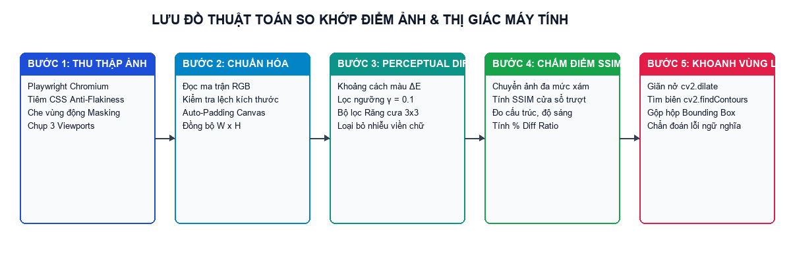
*Hình 1.1: Lưu đồ 5 bước của thuật toán So khớp Điểm ảnh & Thị giác máy tính trong hệ thống*


## 1.3 Thuật Ngữ Chuyên Ngành (Glossary)


| STT | Thuật ngữ | Giải thích chi tiết trong ngữ cảnh hệ thống |
| --- | --- | --- |
| 1 | Visual Regression Testing | Kiểm thử hồi quy giao diện trực quan — phương pháp phát hiện các lỗi hiển thị ngoài ý muốn bằng cách so sánh ảnh chụp màn hình qua các phiên bản. |
| 2 | Baseline Image (Ảnh chuẩn gốc) | Bức ảnh chụp giao diện ở trạng thái chuẩn đã được kiểm duyệt, dùng làm mốc tham chiếu cho các lần chạy kiểm thử sau. |
| 3 | Current Image (Ảnh hiện tại) | Bức ảnh chụp giao diện của phiên bản mã nguồn mới vừa cập nhật cần được kiểm tra đối chiếu với Baseline. |
| 4 | Diff Heatmap (Bản đồ nhiệt vùng lỗi) | Bức ảnh kết quả trong đó các vùng không thay đổi được làm mờ và các điểm ảnh bị lỗi được tô nổi bật bằng màu đỏ dạ quang (#FF0055). |
| 5 | Perceptual Diff (ΔE) | Giải thuật đo khoảng cách màu sắc tri giác giữa hai điểm ảnh trong không gian RGB kèm hệ số dung sai γ. |
| 6 | SSIM (Structural Similarity Index) | Chỉ số đo lường độ tương đồng về cấu trúc bố cục, độ sáng và độ tương phản giữa hai bức ảnh (thang điểm 0.0 đến 1.0). |
| 7 | Diff Ratio (%) | Tỷ lệ phần trăm giữa tổng số điểm ảnh bị lỗi trên tổng số điểm ảnh của toàn bộ bức ảnh chuẩn hóa. |
| 8 | Anti-Flakiness Engine | Cơ chế triệt tiêu báo động giả bằng cách khóa chuyển động CSS, ẩn con trỏ văn bản và đồng bộ phông chữ trước khi chụp. |
| 9 | DOM Masking (Che vùng động) | Kỹ thuật phủ mặt nạ che các phần tử HTML có nội dung biến đổi theo thời gian thực (như đồng hồ .timestamp, bộ đếm). |
| 10 | Anti-Aliasing Filter | Bộ lọc cửa sổ 3×3 giúp phân biệt và loại bỏ các điểm ảnh sai lệch vi mô ở mép chữ do cơ chế làm mịn phông của hệ điều hành. |
| 11 | Bounding Box | Khung chữ nhật [X, Y, Rộng, Cao] bao quanh một cụm điểm ảnh lỗi sau khi gom cụm hình thái học bằng OpenCV. |
| 12 | Viewport Preset | Cấu hình kích thước khung nhìn trình duyệt giả lập thiết bị: Desktop (1920×1080), Tablet (768×1024), Mobile (375×812). |
| 13 | Approve Baseline | Thao tác phê duyệt lấy bộ ảnh Current của phiên chạy hiện tại ghi đè làm bộ ảnh Baseline chuẩn mới. |
| 14 | Headless CLI Gatekeeper | Công cụ dòng lệnh không giao diện (cli.py) chạy trong đường ống CI/CD và trả về Exit Code (0 = Đạt, 1 = Lỗi) để mở hoặc khóa Pull Request. |
| 15 | Ephemeral Static Server | Máy chủ HTTP cục bộ tạm thời được hệ thống khởi tạo tự động để dựng và kiểm thử giao diện của một kho mã nguồn GitHub vừa clone. |

*Bảng 1.5: Bảng giải thích các thuật ngữ chuyên ngành sử dụng trong báo cáo*


## 1.4 Thông Số Kỹ Thuật Bổ Sung (Supplementary Specifications)


### 1.4.1 Yêu Cầu Về Hiệu Năng (Performance)

- Thời gian khởi tạo trình duyệt ngầm và chụp 3 độ phân giải (Desktop, Tablet, Mobile) trung bình từ 3.5 giây đến 8.0 giây.
- Tốc độ xử lý ma trận điểm ảnh (Vectorized NumPy + OpenCV C++ bindings) cho bức ảnh Full HD (1920×1080, hơn 2 triệu điểm ảnh) đạt từ 450ms đến 950ms.


### 1.4.2 Yêu Cầu Về Độ Tin Cậy & Chính Xác (Reliability & Accuracy)

- Đảm bảo tỷ lệ báo động giả (False Positive Rate) bằng 0.0000% khi kiểm thử lặp lại cùng một phiên bản giao diện.
- Tự động xử lý ngoại lệ khi hai trang web có chiều cao khác nhau thông qua cơ chế Canvas Auto-Padding mà không gây sập tiến trình so sánh.


### 1.4.3 Yêu Cầu Về Khả Dụng (Usability)

- Giao diện 100% tiếng Việt chuẩn thuật ngữ Kiểm định Chất lượng Phần mềm.
- Hỗ trợ 5 chế độ đối chiếu quang học trực tiếp trên trình duyệt cùng chế độ Sáng / Tối (Light / Dark Mode).


## 1.5 Mô Hình Hóa Quy Trình Nghiệp Vụ Kiểm Thử

Hệ thống vận hành theo 2 quy trình nghiệp vụ cốt lõi:

- Quy trình nghiệp vụ 1 — Kiểm thử hồi quy tương tác trên Bàn Kiểm Định Web (Tab 01 & Tab 02): Kỹ sư QA thiết lập URL gốc và URL hiện tại → Chụp bộ ảnh chuẩn gốc (Capture Baseline) → Kích hoạt phiên chạy so khớp (Run Visual Test) → Soi lỗi qua 5 chế độ trực quan → Quyết định Báo lỗi (Bug Report) hoặc Duyệt làm chuẩn mới (Approve Baseline).
- Quy trình nghiệp vụ 2 — Cổng kiểm duyệt tự động CI/CD & Kiểm thử kho GitHub (Tab 03 & CLI): Khi có sự kiện đẩy code (git push / Pull Request) hoặc khi người dùng nhập link kho GitHub vào Tab 03 → Hệ thống tự động tải mã nguồn, dựng giao diện web, chụp ảnh 3 màn hình và đối sánh → Trả về Exit Code 0 (Cho phép gộp code) hoặc Exit Code 1 (Chặn Pull Request kèm báo cáo vùng lỗi).


## 1.6 Sơ Lược Về UML & Các Biểu Đồ Sử Dụng Trong Báo Cáo


| Loại biểu đồ UML | Mục đích sử dụng trong báo cáo đồ án |
| --- | --- |
| Use Case Diagram | Xác định ranh giới hệ thống, các tác nhân (Kỹ sư QA, Kỹ sư DevOps/CI-CD) và 18 chức năng nghiệp vụ cốt lõi (UC01 – UC18). |
| Activity Diagram | Mô tả chi tiết luồng hoạt động từng bước và các nhánh rẽ điều kiện của 10 quy trình xử lý trong hệ thống. |
| Sequence Diagram | Mô tả trình tự truyền thông điệp theo thời gian giữa Giao diện React, FastAPI Router, BrowserEngine, DiffEngine và StorageManager. |
| Three-Tier & Schema Diagram | Mô tả kiến trúc phân tầng 3 lớp và cấu trúc lưu trữ thực thể dữ liệu (TestSuite, TestRun, ViewportResult, BoundingBox). |

*Bảng 1.6: Các loại biểu đồ thiết kế sử dụng trong báo cáo*


## 1.7 Công Nghệ Sử Dụng


| Công nghệ / Thư viện | Phiên bản | Vai trò kỹ thuật trong dự án |
| --- | --- | --- |
| Python | 3.10+ | Ngôn ngữ lập trình chính ở tầng Backend, xử lý bất đồng bộ (asyncio) và tính toán ma trận. |
| FastAPI & Uvicorn | 0.110+ | Framework xây dựng RESTful API hiệu năng cao, tự động sinh tài liệu OpenAPI (Swagger UI) và phục vụ gói giao diện tĩnh. |
| Playwright (Chromium) | 1.42+ | Công cụ tự động hóa trình duyệt không giao diện (Headless Browser) dùng để chụp ảnh đa màn hình, tiêm CSS khử nhiễu và che vùng động. |
| OpenCV (opencv-python) | 4.9+ | Thư viện thị giác máy tính dùng cho phép toán giãn nở hình thái học (cv2.dilate) và trích xuất đường bao vùng lỗi (cv2.findContours). |
| scikit-image & NumPy | 0.22+ / 1.26+ | Tính toán ma trận khoảng cách màu Perceptual Diff (ΔE), bộ lọc cửa sổ 3×3 và chỉ số tương đồng cấu trúc SSIM. |
| Pillow (PIL) | 10.2+ | Đọc/ghi tập tin ảnh PNG, chuẩn hóa kích thước khung ảnh (Canvas Auto-Padding) và vẽ đồ họa bản đồ nhiệt (Diff Heatmap). |
| React 19 & Vite | 19.0 / 8.3 | Thư viện xây dựng giao diện người dùng tương tác cao với 3 Tab chức năng và 5 chế độ đối chiếu quang học. |
| Tailwind CSS & Lucide | 3.4+ | Hệ thống định kiểu theo Token thiết kế 3 tầng (Primitive → Semantic → Component) hỗ trợ giao diện Sáng / Tối. |
| GitHub Actions CI/CD | v4 | Nền tảng tự động hóa đường ống kiểm thử trên đám mây mỗi khi có sự kiện git push hoặc Pull Request. |

*Bảng 1.7: Ngăn xếp công nghệ (Tech Stack) sử dụng trong hệ thống*


---


# CHƯƠNG 2: PHÂN TÍCH VÀ THIẾT KẾ HỆ THỐNG


## 2.1 Sơ Đồ Use Case (Use Case Modeling)


### 2.1.1 Tổng Hợp Các Nhóm Chức Năng

Hệ thống được phân chia thành 4 nhóm chức năng nghiệp vụ chính phục vụ 2 tác nhân chính là Kỹ sư Kiểm thử (QA / Tester) và Kỹ sư DevOps / Hệ thống CI-CD:

- Nhóm 1 — Quản lý Kịch bản & Khởi tạo Ảnh Chuẩn Gốc (Suite & Baseline Management): Tạo mới, liệt kê, xóa kịch bản kiểm thử; nạp cấu hình mẫu; chụp bộ ảnh chuẩn gốc (Baseline) trên 3 màn hình và xem trước bộ ảnh chuẩn đã lưu.
- Nhóm 2 — Thực thi Kiểm thử & Phân tích Thị giác Máy tính (Visual Diff & Computer Vision Execution): Chạy phiên kiểm thử so khớp điểm ảnh, tiêm CSS khử nhiễu & che vùng động, tính Perceptual Diff, lọc răng cưa chữ 3×3, chấm điểm SSIM và khoanh vùng lỗi OpenCV kèm chẩn đoán tiếng Việt.
- Nhóm 3 — Đối chiếu Trực quan, Quản lý Lịch sử & Xuất Báo cáo (Interactive Inspection & Reporting): Soi lỗi qua 5 chế độ quang học (Thanh trượt, 3 Cột, Chớp tắt, Mờ đè lớp, Kính lúp), phê duyệt ảnh mới làm Baseline, theo dõi biểu đồ xu hướng, lọc nhật ký lịch sử và xuất báo cáo HTML/PDF.
- Nhóm 4 — Tự động hóa Dòng lệnh CLI & Kiểm thử Kho GitHub CI/CD (CLI & GitHub Repository Automation): Chạy kiểm thử không giao diện qua cli.py (Exit Code 0/1/2), theo dõi trực tiếp GitHub Actions trên đám mây, tự động git clone và kiểm thử hồi quy giao diện trên kho GitHub bất kỳ giữa 2 bản Commit.


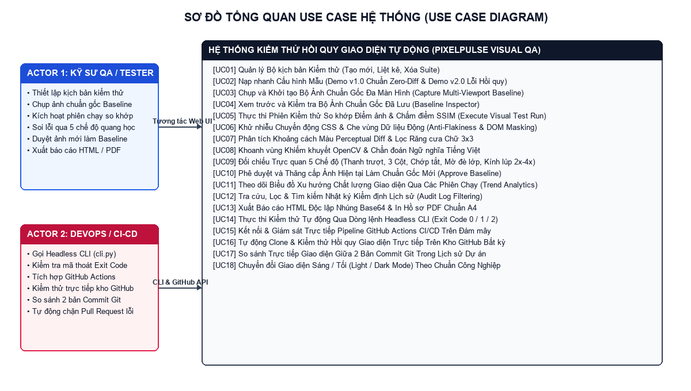
*Hình 2.1: Sơ đồ tổng quan Use Case của Công cụ Tự động Kiểm thử Hồi quy Giao diện*


### 2.1.2 Bảng Ánh Xạ Chức Năng Với Các Use Case (UC01 – UC18)


| STT | Mã UC | Tên Use Case | Tác nhân (Actor) | Module / Endpoint ánh xạ |
| --- | --- | --- | --- | --- |
| 1 | UC01 | Tạo mới và cấu hình Bộ kịch bản kiểm thử (Test Suite) | Kỹ sư QA | POST /api/suites |
| 2 | UC02 | Nạp nhanh cấu hình Kịch bản Mẫu (v1.0 Chuẩn / v2.0 Lỗi) | Kỹ sư QA | TestRunnerForm.jsx |
| 3 | UC03 | Chụp và khởi tạo Bộ ảnh chuẩn gốc đa màn hình (Capture Baseline) | Kỹ sư QA, CLI | POST /api/suites/{id}/capture-baseline |
| 4 | UC04 | Xem trước và kiểm tra Bộ ảnh chuẩn gốc đã lưu (Baseline Viewer) | Kỹ sư QA | GET /api/suites/{id}/baselines |
| 5 | UC05 | Kích hoạt Phiên kiểm thử so khớp giao diện (Execute Visual Run) | Kỹ sư QA, CLI | POST /api/suites/{id}/run |
| 6 | UC06 | Tiêm CSS khử nhiễu chuyển động & Che vùng động (DOM Masking) | BrowserEngine | app/services/browser_engine.py |
| 7 | UC07 | Tính khoảng cách màu Perceptual Diff & Lọc răng cưa chữ 3×3 | DiffEngine | app/services/diff_engine.py |
| 8 | UC08 | Gom cụm vùng lỗi OpenCV & Sinh chẩn đoán ngữ nghĩa tiếng Việt | DiffEngine | app/services/diff_engine.py |
| 9 | UC09 | Đối chiếu trực quan qua 5 chế độ (Thanh trượt, 3 Cột, Chớp tắt, Mờ, Kính lúp) | Kỹ sư QA | DiffViewer.jsx / MagnifierCompare.jsx |
| 10 | UC10 | Phê duyệt và thăng cấp ảnh hiện tại làm Baseline mới (Approve Baseline) | Kỹ sư QA, Product Owner | POST /api/runs/{run_id}/approve |
| 11 | UC11 | Theo dõi Biểu đồ xu hướng chất lượng giao diện (Trend Analytics) | Kỹ sư QA, Tech Lead | TrendChart.jsx (Tab 02) |
| 12 | UC12 | Tra cứu, lọc trạng thái và tìm kiếm Nhật ký lịch sử kiểm định | Kỹ sư QA | GET /api/runs (Tab 02) |
| 13 | UC13 | Xuất Báo cáo HTML độc lập (nhúng Base64) & In hồ sơ PDF chuẩn A4 | Kỹ sư QA | GET /api/runs/{run_id}/report |
| 14 | UC14 | Thực thi Cổng kiểm duyệt dòng lệnh Headless CLI (Exit Code 0/1/2) | Kỹ sư DevOps, CI/CD | cli.py / backend/app/cli.py |
| 15 | UC15 | Kết nối và giám sát trực tiếp Pipeline GitHub Actions trên đám mây | Kỹ sư QA, DevOps | CiCdPanel.jsx (Mục 01 - Tab 03) |
| 16 | UC16 | Tự động Clone và kiểm thử giả lập lỗi hồi quy trên kho GitHub bất kỳ | Kỹ sư QA, DevOps | POST /api/suites/run-github |
| 17 | UC17 | So sánh trực tiếp giao diện giữa 2 bản Commit Git của dự án GitHub | Kỹ sư QA, Tech Lead | POST /api/suites/run-github |
| 18 | UC18 | Chuyển đổi chế độ Giao diện Sáng / Tối (Light / Dark Theme) | Kỹ sư QA | App.jsx / index.css |

*Bảng 2.1: Bảng ánh xạ 18 Use Cases với các Module và REST API trong hệ thống*


### 2.1.3 Đặc Tả Chi Tiết Các Use Case (UC01 – UC18)


#### Đặc tả UC01: Tạo mới và cấu hình Bộ kịch bản kiểm thử (Create Test Suite)


| Trường thông tin | Nội dung đặc tả chi tiết |
| --- | --- |
| Mã & Tên Use Case | UC01 — Tạo mới và cấu hình Bộ kịch bản kiểm thử (Create Test Suite) |
| Tác nhân (Actor) | Kỹ sư Kiểm thử (QA Engineer) |
| Mô tả tóm tắt | Cho phép người dùng khai báo tên bộ kịch bản, đường dẫn URL bản gốc (Baseline URL), đường dẫn URL bản cần kiểm tra (Current URL), chọn danh sách độ phân giải màn hình (Desktop, Tablet, Mobile), thiết lập ngưỡng sai lệch điểm ảnh cho phép (%) và danh sách CSS Selectors cần che vùng động. |
| Tiền điều kiện (Pre-conditions) | Máy chủ FastAPI đang hoạt động; người dùng mở Bàn Kiểm Định tại Tab 01. |
| Hậu điều kiện (Post-conditions) | Bản ghi cấu hình kịch bản mới được lưu vào kho metadata (suites.json) với mã định danh duy nhất (suite_id). |
| Luồng sự kiện chính (Main Flow) | 1. Người dùng nhập Tên kịch bản, Baseline URL và Current URL trên biểu mẫu cấu hình tại Tab 01.<br>2. Người dùng chọn các thiết bị cần kiểm tra (mặc định chọn cả 3: Desktop 1920×1080, Tablet 768×1024, Mobile 375×812).<br>3. Người dùng mở mục 'Tùy chỉnh nâng cao' (nếu cần) để điều chỉnh ngưỡng sai lệch (mặc định 0.05%) và danh sách CSS Selectors che vùng động (.timestamp, #live-visitors-counter).<br>4. Giao diện gửi yêu cầu POST /api/suites kèm dữ liệu JSON tới Backend.<br>5. StorageManager kiểm tra tính hợp lệ qua Pydantic Schema (TestSuiteCreate), cấp phát mã UUID 8 ký tự và lưu vào suites.json. |
| Luồng ngoại lệ (Exception Flow) | Nếu thiếu URL hoặc định dạng URL không hợp lệ (không bắt đầu bằng http:// hoặc https://), hệ thống hiển thị thông báo lỗi yêu cầu nhập đúng định dạng. |

*Bảng đặc tả UC01: Tạo mới và cấu hình Bộ kịch bản kiểm thử (Create Test Suite)*


#### Đặc tả UC02: Nạp nhanh cấu hình Kịch bản Mẫu (Load Preset Demo v1.0 / v2.0)


| Trường thông tin | Nội dung đặc tả chi tiết |
| --- | --- |
| Mã & Tên Use Case | UC02 — Nạp nhanh cấu hình Kịch bản Mẫu (Load Preset Demo v1.0 / v2.0) |
| Tác nhân (Actor) | Kỹ sư Kiểm thử (QA Engineer) / Giảng viên đánh giá |
| Mô tả tóm tắt | Giúp người dùng nạp tức thì cấu hình kiểm thử chuẩn (v1.0 vs v1.0) hoặc cấu hình kiểm thử lỗi hồi quy (v1.0 vs v2.0) chỉ bằng 1 cú nhấp chuột mà không cần gõ tay đường dẫn URL. |
| Tiền điều kiện (Pre-conditions) | Người dùng đang ở Tab 01 (Bàn Kiểm Định & So Khớp). |
| Hậu điều kiện (Post-conditions) | Các ô nhập liệu trên biểu mẫu được điền tự động chính xác đường dẫn URL gốc, URL hiện tại, ngưỡng dung sai 0.05% và bộ lọc .timestamp, #live-visitors-counter. |
| Luồng sự kiện chính (Main Flow) | 1. Tại thanh tiêu đề của biểu mẫu Tab 01, người dùng bấm nút 'Nạp Mẫu v1.0 Chuẩn (Gốc vs Gốc)' hoặc 'Nạp Mẫu v2.0 Lỗi (Gốc vs Lỗi)'.<br>2. Hàm loadPreset() trong TestRunnerForm.jsx cập nhật tức thì state formData.<br>3. Giao diện phản hồi trực quan giúp người dùng sẵn sàng bấm chụp ảnh gốc hoặc chạy kiểm thử ngay. |
| Luồng ngoại lệ (Exception Flow) | Không có ngoại lệ do dữ liệu mẫu được cấu hình tĩnh an toàn ngay trong mã nguồn Frontend. |

*Bảng đặc tả UC02: Nạp nhanh cấu hình Kịch bản Mẫu (Load Preset Demo v1.0 / v2.0)*


#### Đặc tả UC03: Chụp và khởi tạo Bộ ảnh chuẩn gốc đa màn hình (Capture Multi-Viewport Baseline)


| Trường thông tin | Nội dung đặc tả chi tiết |
| --- | --- |
| Mã & Tên Use Case | UC03 — Chụp và khởi tạo Bộ ảnh chuẩn gốc đa màn hình (Capture Multi-Viewport Baseline) |
| Tác nhân (Actor) | Kỹ sư QA / Công cụ dòng lệnh CLI |
| Mô tả tóm tắt | Khởi chạy trình duyệt ngầm Playwright Chromium truy cập vào đường dẫn Baseline URL, thực thi khử nhiễu và chụp bộ ảnh chuẩn gốc trên tất cả các màn hình đã chọn. |
| Tiền điều kiện (Pre-conditions) | Kịch bản kiểm thử (Suite) đã được tạo hoặc vừa được gửi kèm từ biểu mẫu; trang web đích có thể truy cập được. |
| Hậu điều kiện (Post-conditions) | Các tập tin ảnh chuẩn (baseline_desktop.png, baseline_tablet.png, baseline_mobile.png) được lưu vào thư mục storage/baselines/{suite_id}/ và cờ has_baseline của kịch bản chuyển thành true. |
| Luồng sự kiện chính (Main Flow) | 1. Người dùng bấm nút '1. Chụp Ảnh Gốc (Baseline)' trên Tab 01 (hoặc chạy lệnh python cli.py --capture-baseline).<br>2. Backend nhận yêu cầu tại endpoint POST /api/suites/{suite_id}/capture-baseline.<br>3. BrowserEngine khởi tạo trình duyệt Headless Chromium và lặp qua từng độ phân giải (Desktop, Tablet, Mobile).<br>4. Tại mỗi màn hình, trình duyệt điều hướng tới Baseline URL, tiêm CSS Anti-Flakiness, chờ phông chữ sẵn sàng, che các vùng động và chụp ảnh toàn trang.<br>5. Hệ thống lưu ảnh vào đĩa và trả về danh sách BaselineItem kèm kích thước ảnh (px) và dung lượng (KB). |
| Luồng ngoại lệ (Exception Flow) | Nếu trang web đích không phản hồi sau 15 giây, BrowserEngine tự động ghi nhận cảnh báo Timeout và chụp trạng thái hiện có hoặc trả về mã lỗi HTTP 500 rõ ràng. |

*Bảng đặc tả UC03: Chụp và khởi tạo Bộ ảnh chuẩn gốc đa màn hình (Capture Multi-Viewport Baseline)*


#### Đặc tả UC04: Xem trước và kiểm tra Bộ ảnh chuẩn gốc đã lưu (Baseline Viewer)


| Trường thông tin | Nội dung đặc tả chi tiết |
| --- | --- |
| Mã & Tên Use Case | UC04 — Xem trước và kiểm tra Bộ ảnh chuẩn gốc đã lưu (Baseline Viewer) |
| Tác nhân (Actor) | Kỹ sư Kiểm thử (QA Engineer) |
| Mô tả tóm tắt | Hiển thị trực quan các bức ảnh chuẩn gốc (Baseline) vừa chụp trên Desktop, Tablet, Mobile kèm thông số độ phân giải và dung lượng tập tin để QA xác nhận ảnh gốc đã sạch trước khi chạy so khớp. |
| Tiền điều kiện (Pre-conditions) | Bước chụp ảnh gốc (UC03) vừa hoàn tất thành công. |
| Hậu điều kiện (Post-conditions) | Khung 'Bộ Ảnh Chuẩn Gốc (Baseline) Đã Lưu' hiển thị rõ nét 3 bức ảnh gốc trên màn hình Tab 01. |
| Luồng sự kiện chính (Main Flow) | 1. Ngay sau khi API capture-baseline trả về kết quả, App.jsx cập nhật state capturedBaselinesInfo.<br>2. Thành phần BaselineViewer.jsx dựng lưới 3 cột hiển thị ảnh chuẩn của Desktop, Tablet và Mobile.<br>3. Người dùng có thể bấm vào từng ảnh để mở xem kích thước thật trong tab mới hoặc bấm 'Đóng khung xem trước'. |
| Luồng ngoại lệ (Exception Flow) | Nếu tập tin ảnh bị xóa thủ công khỏi đĩa cứng, giao diện hiển thị khung báo thiếu ảnh chuẩn. |

*Bảng đặc tả UC04: Xem trước và kiểm tra Bộ ảnh chuẩn gốc đã lưu (Baseline Viewer)*


#### Đặc tả UC05: Kích hoạt Phiên kiểm thử so khớp giao diện (Execute Visual Regression Run)


| Trường thông tin | Nội dung đặc tả chi tiết |
| --- | --- |
| Mã & Tên Use Case | UC05 — Kích hoạt Phiên kiểm thử so khớp giao diện (Execute Visual Regression Run) |
| Tác nhân (Actor) | Kỹ sư Kiểm thử (QA Engineer) / CLI |
| Mô tả tóm tắt | Thực thi một phiên kiểm thử hồi quy hoàn chỉnh: chụp ảnh trang web hiện tại (Current URL), đối sánh từng điểm ảnh với bộ ảnh chuẩn gốc (Baseline), chấm điểm SSIM, khoanh vùng lỗi và tổng hợp kết quả. |
| Tiền điều kiện (Pre-conditions) | Đã có bộ ảnh chuẩn gốc (hoặc hệ thống tự động chụp từ baseline_url nếu chạy lần đầu). |
| Hậu điều kiện (Post-conditions) | Bản ghi phiên chạy (TestRun) được lưu vào runs.json, các ảnh current/diff và báo cáo report.html được lưu vào storage/runs/{run_id}/. |
| Luồng sự kiện chính (Main Flow) | 1. Người dùng bấm nút '2. Chạy So Khớp Kiểm Thử' trên Tab 01.<br>2. Frontend gọi API POST /api/suites/{suite_id}/run.<br>3. Dịch vụ test_runner.py kiểm tra sự tồn tại của ảnh Baseline (nếu chưa có sẽ tự động chụp từ baseline_url).<br>4. BrowserEngine chụp ảnh Current URL trên cả 3 màn hình (current_desktop.png, current_tablet.png, current_mobile.png).<br>5. DiffEngine thực thi thuật toán so sánh trên từng màn hình và trả về kết quả chi tiết.<br>6. ReportGenerator xuất báo cáo HTML độc lập và trả toàn bộ đối tượng TestRunResponse về cho giao diện hiển thị. |
| Luồng ngoại lệ (Exception Flow) | Nếu quá trình kết nối tới Current URL bị từ chối (Connection Refused), phiên chạy được đánh dấu trạng thái ERROR kèm thông điệp chẩn đoán. |

*Bảng đặc tả UC05: Kích hoạt Phiên kiểm thử so khớp giao diện (Execute Visual Regression Run)*


#### Đặc tả UC06: Tiêm CSS khử nhiễu chuyển động & Che vùng dữ liệu động (Anti-Flakiness & DOM Masking)


| Trường thông tin | Nội dung đặc tả chi tiết |
| --- | --- |
| Mã & Tên Use Case | UC06 — Tiêm CSS khử nhiễu chuyển động & Che vùng dữ liệu động (Anti-Flakiness & DOM Masking) |
| Tác nhân (Actor) | BrowserEngine (Tác nhân hệ thống tự động) |
| Mô tả tóm tắt | Đảm bảo trạng thái hiển thị của trang web hoàn toàn tĩnh và đồng nhất trước thời điểm bấm máy chụp màn hình nhằm triệt tiêu Sai số Loại I (False Positives). |
| Tiền điều kiện (Pre-conditions) | Trang web đích đã được tải vào trình duyệt Playwright Chromium. |
| Hậu điều kiện (Post-conditions) | Mọi hiệu ứng animation/transition bị vô hiệu hóa, phông chữ tải xong 100% và các phần tử động bị che kín. |
| Luồng sự kiện chính (Main Flow) | 1. BrowserEngine gọi page.add_style_tag() tiêm đoạn mã ANTI_FLAKINESS_CSS tắt toàn bộ animation, transition và con trỏ chuột.<br>2. Thực thi mã JavaScript chờ Promise document.fonts.ready hoàn tất và cuộn trang về tọa độ (0, 0).<br>3. Duyệt qua danh sách mask_selectors (ví dụ: .timestamp, #live-visitors-counter) và đặt thuộc tính visibility: hidden cùng màu nền trung tính.<br>4. Chờ thêm 300ms ổn định khung hình (stabilization delay) trước khi gọi page.screenshot(full_page=True). |
| Luồng ngoại lệ (Exception Flow) | Nếu một CSS Selector trong danh sách che vùng động không tồn tại trên trang, hệ thống bỏ qua an toàn mà không báo lỗi. |

*Bảng đặc tả UC06: Tiêm CSS khử nhiễu chuyển động & Che vùng dữ liệu động (Anti-Flakiness & DOM Masking)*


#### Đặc tả UC07: Tính khoảng cách màu Perceptual Diff & Lọc răng cưa chữ 3×3


| Trường thông tin | Nội dung đặc tả chi tiết |
| --- | --- |
| Mã & Tên Use Case | UC07 — Tính khoảng cách màu Perceptual Diff & Lọc răng cưa chữ 3×3 |
| Tác nhân (Actor) | DiffEngine (Tác nhân hệ thống tự động) |
| Mô tả tóm tắt | So sánh hai bức ảnh Baseline và Current ở cấp độ ma trận điểm ảnh RGB, loại bỏ nhiễu viền chữ và tính toán tỷ lệ phần trăm sai lệch (Diff Ratio %) cùng điểm cấu trúc SSIM. |
| Tiền điều kiện (Pre-conditions) | Hai tập tin ảnh Baseline và Current của cùng một độ phân giải đã tồn tại trên đĩa. |
| Hậu điều kiện (Post-conditions) | Tạo ra mặt nạ nhị phân các điểm ảnh lỗi thực sự, bản đồ nhiệt diff_<viewport>.png, chỉ số diff_ratio (%) và ssim_score. |
| Luồng sự kiện chính (Main Flow) | 1. DiffEngine đọc hai ảnh bằng Pillow, kiểm tra kích thước và tự động đệm khung (Canvas Auto-Padding) nếu chiều cao lệch nhau.<br>2. Chuyển đổi sang mảng NumPy float32 và tính khoảng cách màu Euclidean chuẩn hóa ΔE cho toàn bộ điểm ảnh.<br>3. Lọc các điểm ảnh có ΔE > color_threshold (0.1).<br>4. Áp dụng bộ lọc cửa sổ trượt 3×3 (_detect_anti_aliasing) để loại trừ các điểm ảnh nằm trên mép chữ do làm mịn phông.<br>5. Tính chỉ số tương đồng cấu trúc SSIM qua thư viện scikit-image và kết luận PASSED nếu diff_ratio <= threshold (0.05%). |
| Luồng ngoại lệ (Exception Flow) | Nếu ảnh đầu vào bị hỏng định dạng, hệ thống ném ngoại lệ FileNotFoundError / IOError để tầng điều phối xử lý. |

*Bảng đặc tả UC07: Tính khoảng cách màu Perceptual Diff & Lọc răng cưa chữ 3×3*


#### Đặc tả UC08: Gom cụm vùng lỗi OpenCV & Sinh chẩn đoán ngữ nghĩa tiếng Việt


| Trường thông tin | Nội dung đặc tả chi tiết |
| --- | --- |
| Mã & Tên Use Case | UC08 — Gom cụm vùng lỗi OpenCV & Sinh chẩn đoán ngữ nghĩa tiếng Việt |
| Tác nhân (Actor) | DiffEngine (Tác nhân hệ thống tự động) |
| Mô tả tóm tắt | Gom các điểm ảnh lỗi rời rạc thành các khung chữ nhật bao quanh từng thành phần giao diện bị hỏng và tự động phân tích nguyên nhân lỗi bằng ngôn ngữ tự nhiên tiếng Việt. |
| Tiền điều kiện (Pre-conditions) | Mặt nạ điểm ảnh lỗi M_final có ít nhất một vùng điểm ảnh khác không. |
| Hậu điều kiện (Post-conditions) | Danh sách các đối tượng BoundingBox [x, y, width, height, region_name, defect_type, severity, description] và bản tóm tắt executive_summary. |
| Luồng sự kiện chính (Main Flow) | 1. Áp dụng phép giãn nở hình thái học cv2.dilate với nhân 15×15 lên mặt nạ điểm ảnh lỗi.<br>2. Tìm danh sách đường bao ngoài bằng cv2.findContours và lọc bỏ các hạt nhiễu siêu nhỏ (< 25px²).<br>3. Thực hiện thuật toán gộp các hộp chữ nhật giao nhau hoặc nằm sát nhau (< 18px) để tạo khung bao gọn gàng.<br>4. Tại mỗi khung bao, đối sánh màu sắc trung bình và trọng tâm độ sáng giữa ảnh Baseline và Current để phân loại: 'Sai Màu Sắc', 'Lệch Bố Cục (Layout Shift)' hay 'Thay Đổi Nội Dung / Kích Thước'. |
| Luồng ngoại lệ (Exception Flow) | Nếu hai bức ảnh giống hệt nhau (0 điểm lỗi), hàm trả về danh sách rỗng [] và thông điệp xác nhận giao diện bảo toàn 100%. |

*Bảng đặc tả UC08: Gom cụm vùng lỗi OpenCV & Sinh chẩn đoán ngữ nghĩa tiếng Việt*


#### Đặc tả UC09: Đối chiếu trực quan qua 5 chế độ quang học trên Bàn Kiểm Định


| Trường thông tin | Nội dung đặc tả chi tiết |
| --- | --- |
| Mã & Tên Use Case | UC09 — Đối chiếu trực quan qua 5 chế độ quang học trên Bàn Kiểm Định |
| Tác nhân (Actor) | Kỹ sư Kiểm thử (QA Engineer) |
| Mô tả tóm tắt | Cung cấp 5 công cụ quan sát trực quan chuyên sâu giúp người kiểm thử soi rõ từng điểm khác biệt giữa ảnh Gốc và ảnh Hiện tại trên cả 3 thiết bị. |
| Tiền điều kiện (Pre-conditions) | Đã có kết quả của một phiên chạy kiểm thử (activeRun khác null). |
| Hậu điều kiện (Post-conditions) | Người dùng quan sát, phóng đại và định vị chính xác từng vùng lỗi ngay trên trình duyệt. |
| Luồng sự kiện chính (Main Flow) | 1. Người dùng chọn tab màn hình muốn xem: Desktop (1920px), Tablet (768px) hoặc Mobile (375px).<br>2. Người dùng chuyển đổi linh hoạt giữa 5 chế độ trên thanh công cụ: (a) Thanh Trượt (kéo qua lại), (b) 3 Cột Song Song (kèm bật/tắt khung đánh số vùng lỗi), (c) Chớp Tắt & Mờ Đè Lớp, (d) Chỉ Vùng Lỗi, (e) Kính Lúp Phóng Đại (2× / 3× / 4×).<br>3. Người dùng đọc danh sách 'Chi Tiết Các Vùng Phát Hiện Sai Lệch' ngay bên dưới để nắm rõ tọa độ và nguyên nhân lỗi. |
| Luồng ngoại lệ (Exception Flow) | Không có. |

*Bảng đặc tả UC09: Đối chiếu trực quan qua 5 chế độ quang học trên Bàn Kiểm Định*


#### Đặc tả UC10: Phê duyệt và thăng cấp ảnh hiện tại làm Baseline mới (Approve Baseline)


| Trường thông tin | Nội dung đặc tả chi tiết |
| --- | --- |
| Mã & Tên Use Case | UC10 — Phê duyệt và thăng cấp ảnh hiện tại làm Baseline mới (Approve Baseline) |
| Tác nhân (Actor) | Kỹ sư QA / Quản lý Sản phẩm (Product Owner) |
| Mô tả tóm tắt | Khi sự thay đổi giao diện là tính năng mới có chủ đích (không phải lỗi), người dùng phê duyệt lấy bộ ảnh Current của phiên chạy hiện tại làm bộ ảnh chuẩn gốc (Baseline) mới. |
| Tiền điều kiện (Pre-conditions) | Phiên chạy hiện tại đã hoàn tất và có đầy đủ ảnh Current. |
| Hậu điều kiện (Post-conditions) | Các ảnh Current được sao chép đè vào thư mục baselines/{suite_id}/, trạng thái phiên chạy cập nhật thành PASSED (diff_ratio = 0.0%, ssim = 1.0). |
| Luồng sự kiện chính (Main Flow) | 1. Tại thanh công cụ của Bàn Kiểm Định (Tab 01), người dùng bấm nút màu xanh lá 'Duyệt Làm Ảnh Chuẩn Mới'.<br>2. Hệ thống hiển thị hộp thoại xác nhận để tránh bấm nhầm.<br>3. Frontend gọi API POST /api/runs/{run_id}/approve.<br>4. StorageManager sao chép toàn bộ ảnh current_<vp>.png sang baseline_<vp>.png và cập nhật bản ghi phiên chạy sang trạng thái PASSED. |
| Luồng ngoại lệ (Exception Flow) | Nếu không tìm thấy tập tin ảnh Current trên đĩa, API trả về mã lỗi 400 Bad Request. |

*Bảng đặc tả UC10: Phê duyệt và thăng cấp ảnh hiện tại làm Baseline mới (Approve Baseline)*


#### Đặc tả UC11: Theo dõi Biểu đồ xu hướng chất lượng giao diện (Trend Analytics)


| Trường thông tin | Nội dung đặc tả chi tiết |
| --- | --- |
| Mã & Tên Use Case | UC11 — Theo dõi Biểu đồ xu hướng chất lượng giao diện (Trend Analytics) |
| Tác nhân (Actor) | Kỹ sư QA / Trưởng nhóm Kỹ thuật (Tech Lead) |
| Mô tả tóm tắt | Hiển thị biểu đồ biến thiên của Tỷ lệ sai lệch điểm ảnh trung bình (Avg Diff %) và Điểm tương đồng cấu trúc (Avg SSIM %) qua 10 phiên kiểm thử gần nhất. |
| Tiền điều kiện (Pre-conditions) | Hệ thống có ít nhất 1 phiên kiểm thử trong lịch sử. |
| Hậu điều kiện (Post-conditions) | Biểu đồ cột đôi hiển thị trực quan sự cải thiện hoặc suy giảm chất lượng giao diện theo thời gian. |
| Luồng sự kiện chính (Main Flow) | 1. Người dùng chuyển sang Tab '02 / Xu Hướng & Lịch Sử' (hoặc cuộn xuống cuối Tab 01).<br>2. Thành phần TrendChart.jsx trích xuất 10 phiên chạy gần nhất, tính trung bình cộng diff_ratio và ssim_score trên 3 màn hình.<br>3. Vẽ biểu đồ trực quan kèm thẻ thống kê: Tổng số phiên, Tỷ lệ Đạt chuẩn (%), Sai lệch trung bình và SSIM trung bình. |
| Luồng ngoại lệ (Exception Flow) | Không có. |

*Bảng đặc tả UC11: Theo dõi Biểu đồ xu hướng chất lượng giao diện (Trend Analytics)*


#### Đặc tả UC12: Tra cứu, lọc trạng thái và tìm kiếm Nhật ký lịch sử kiểm định


| Trường thông tin | Nội dung đặc tả chi tiết |
| --- | --- |
| Mã & Tên Use Case | UC12 — Tra cứu, lọc trạng thái và tìm kiếm Nhật ký lịch sử kiểm định |
| Tác nhân (Actor) | Kỹ sư Kiểm thử (QA Engineer) |
| Mô tả tóm tắt | Cho phép lọc danh sách các phiên kiểm thử theo trạng thái (Tất cả / Đạt / Lỗi), tìm kiếm theo từ khóa và bấm vào bất kỳ phiên cũ nào để nạp lại bộ ảnh kiểm định. |
| Tiền điều kiện (Pre-conditions) | Người dùng đang ở bảng 'Nhật Ký Kiểm Định Lịch Sử'. |
| Hậu điều kiện (Post-conditions) | Danh sách phiên chạy được lọc tức thì; khi nhấp vào một dòng, toàn bộ ảnh của phiên đó được mở lại trên Bàn Kiểm Định. |
| Luồng sự kiện chính (Main Flow) | 1. Người dùng chọn bộ lọc trạng thái ('Tất cả', 'Đạt', 'Lỗi') hoặc gõ tên dự án / mã phiên vào ô tìm kiếm.<br>2. Bảng lịch sử lọc các bản ghi khớp điều kiện theo thời gian thực.<br>3. Khi người dùng nhấp chuột vào một dòng bất kỳ, hệ thống gọi handleSelectHistoricalRun() nạp lại phiên chạy đó. |
| Luồng ngoại lệ (Exception Flow) | Nếu không có bản ghi nào khớp từ khóa tìm kiếm, bảng hiển thị thông báo 'Không có phiên kiểm thử nào khớp với bộ lọc hiện tại'. |

*Bảng đặc tả UC12: Tra cứu, lọc trạng thái và tìm kiếm Nhật ký lịch sử kiểm định*


#### Đặc tả UC13: Xuất Báo cáo HTML độc lập (nhúng Base64) & In hồ sơ PDF chuẩn A4


| Trường thông tin | Nội dung đặc tả chi tiết |
| --- | --- |
| Mã & Tên Use Case | UC13 — Xuất Báo cáo HTML độc lập (nhúng Base64) & In hồ sơ PDF chuẩn A4 |
| Tác nhân (Actor) | Kỹ sư Kiểm thử (QA Engineer) |
| Mô tả tóm tắt | Tạo tập tin báo cáo HTML độc lập chứa toàn bộ thông số và hình ảnh đã mã hóa Base64 (có thể gửi qua email và mở trên mọi máy tính không cần mạng) hoặc xuất thẳng ra PDF khổ A4. |
| Tiền điều kiện (Pre-conditions) | Phiên kiểm thử đã hoàn tất. |
| Hậu điều kiện (Post-conditions) | Tập tin báo cáo HTML mở trong tab mới hoặc hộp thoại In/Lưu PDF chuẩn A4 được kích hoạt. |
| Luồng sự kiện chính (Main Flow) | 1. Người dùng bấm nút 'Mở Báo Cáo HTML' ở góc phải Bàn Kiểm Định (hoặc cột ngoài cùng của Bảng lịch sử).<br>2. Trình duyệt mở đường dẫn GET /api/runs/{run_id}/report.<br>3. Trên trang báo cáo (hoặc ngay trên Dashboard), người dùng bấm 'In / Lưu PDF' để xuất bản in khổ A4 đã được tối ưu bằng @media print. |
| Luồng ngoại lệ (Exception Flow) | Không có. |

*Bảng đặc tả UC13: Xuất Báo cáo HTML độc lập (nhúng Base64) & In hồ sơ PDF chuẩn A4*


#### Đặc tả UC14: Thực thi Cổng kiểm duyệt dòng lệnh Headless CLI (Exit Code 0/1/2)


| Trường thông tin | Nội dung đặc tả chi tiết |
| --- | --- |
| Mã & Tên Use Case | UC14 — Thực thi Cổng kiểm duyệt dòng lệnh Headless CLI (Exit Code 0/1/2) |
| Tác nhân (Actor) | Kỹ sư DevOps / Máy chủ CI-CD (GitHub Actions, GitLab CI, Jenkins) |
| Mô tả tóm tắt | Cho phép kích hoạt toàn bộ quy trình chụp Baseline, chạy so khớp điểm ảnh và xuất báo cáo ngay từ cửa sổ dòng lệnh không cần mở giao diện web, trả về mã thoát chuẩn hệ điều hành. |
| Tiền điều kiện (Pre-conditions) | Môi trường Python đã cài đặt Playwright Chromium. |
| Hậu điều kiện (Post-conditions) | In bảng kết quả kiểm định ra màn hình Console, lưu báo cáo HTML/JSON và kết thúc tiến trình với Exit Code 0 (PASSED) hoặc Exit Code 1 (FAILED). |
| Luồng sự kiện chính (Main Flow) | 1. Người dùng hoặc script CI/CD gọi lệnh: python cli.py --mode regression --reset-baseline --output-html ci_reports/report.html.<br>2. Module app/cli.py khởi chạy máy chủ HTTP nội bộ (nếu kiểm thử trang demo cục bộ), gọi execute_test_run() và thu thập kết quả.<br>3. Xuất bảng tổng kết ASCII ra Terminal, ghi GitHub Step Summary (nếu đang chạy trên GitHub Actions) và gọi sys.exit(0) hoặc sys.exit(1). |
| Luồng ngoại lệ (Exception Flow) | Nếu tham số dòng lệnh sai hoặc URL không hợp lệ, tiến trình kết thúc với Exit Code 2 (Execution Error). |

*Bảng đặc tả UC14: Thực thi Cổng kiểm duyệt dòng lệnh Headless CLI (Exit Code 0/1/2)*


#### Đặc tả UC15: Kết nối và giám sát trực tiếp Pipeline GitHub Actions trên đám mây


| Trường thông tin | Nội dung đặc tả chi tiết |
| --- | --- |
| Mã & Tên Use Case | UC15 — Kết nối và giám sát trực tiếp Pipeline GitHub Actions trên đám mây |
| Tác nhân (Actor) | Kỹ sư QA / Kỹ sư DevOps |
| Mô tả tóm tắt | Truy vấn trực tiếp GitHub REST API của kho mã nguồn để hiển thị danh sách các phiên chạy tự động (Workflow Runs) trên đám mây và chi tiết từng bước thực thi (Steps). |
| Tiền điều kiện (Pre-conditions) | Kho mã nguồn GitHub ở chế độ công khai (Public). |
| Hậu điều kiện (Post-conditions) | Hiển thị danh sách các phiên chạy GitHub Actions kèm trạng thái Thành công / Thất bại và log từng bước. |
| Luồng sự kiện chính (Main Flow) | 1. Người dùng mở Tab '03 / Tích Hợp CLI & CI/CD', nhập đường dẫn kho GitHub vào Mục 01 và bấm 'Nạp Dự Án GitHub Này'.<br>2. Giao diện gọi song song GitHub API: /repos/{slug}, /repos/{slug}/actions/runs và /repos/{slug}/commits.<br>3. Hiển thị lịch sử các lần chạy tự động bên cột trái và chi tiết từng bước cài đặt/kiểm thử bên cột phải. |
| Luồng ngoại lệ (Exception Flow) | Nếu đường dẫn GitHub không tồn tại (HTTP 404), hệ thống hiển thị thông báo lỗi tiếng Việt rõ ràng. |

*Bảng đặc tả UC15: Kết nối và giám sát trực tiếp Pipeline GitHub Actions trên đám mây*


#### Đặc tả UC16: Tự động Clone và kiểm thử giả lập lỗi hồi quy trên kho GitHub bất kỳ


| Trường thông tin | Nội dung đặc tả chi tiết |
| --- | --- |
| Mã & Tên Use Case | UC16 — Tự động Clone và kiểm thử giả lập lỗi hồi quy trên kho GitHub bất kỳ |
| Tác nhân (Actor) | Kỹ sư QA / Giảng viên đánh giá |
| Mô tả tóm tắt | Cho phép nhập bất kỳ link kho mã nguồn dự án web nào trên GitHub; hệ thống tự động git clone dự án đó về, dựng giao diện web thực tế của dự án và tiêm lỗi CSS hồi quy để chứng minh Cổng CI/CD phát hiện đúng vùng lỗi. |
| Tiền điều kiện (Pre-conditions) | Kho GitHub đích có chứa giao diện web tĩnh hoặc gói build sẵn (frontend/dist, dist, build, index.html). |
| Hậu điều kiện (Post-conditions) | Hệ thống chụp được 6 bức ảnh thực tế của dự án GitHub đó, khoanh vùng các phần tử bị lỗi CSS, trả về Exit Code 1 và hiển thị ngay 3 ảnh (Baseline, Current, Diff) dưới màn hình Terminal. |
| Luồng sự kiện chính (Main Flow) | 1. Tại Mục 02 của Tab 03, người dùng chọn 'Chế độ 1: Giả lập Lỗi Hồi quy CSS trực tiếp trên giao diện dự án' và bấm 'Chạy Kiểm Thử Dự Án ... Ngay'.<br>2. Backend nhận yêu cầu tại POST /api/suites/run-github.<br>3. Dịch vụ github_runner.py thực thi git clone --depth 25 kho GitHub về thư mục đệm repos_cache/.<br>4. Hàm find_web_root_in_repo() tự động dò tìm thư mục chứa index.html (ưu tiên frontend/dist hoặc dist) và mở EphemeralStaticServer.<br>5. Playwright chụp bộ ảnh gốc (Baseline) sạch, sau đó tiêm khối CSS_REGRESSION_MUTATION làm đổi màu/xô lệch nút bấm và tiêu đề, chụp bộ ảnh hiện tại (Current) và chạy DiffEngine.<br>6. Giao diện Tab 03 in bảng kết quả CLI Gatekeeper kèm 3 bức ảnh chụp thực tế của dự án GitHub đó. |
| Luồng ngoại lệ (Exception Flow) | Nếu kho GitHub chỉ chứa mã nguồn hậu cần (Backend thuần không có bất kỳ file HTML giao diện nào), hệ thống thông báo không tìm thấy giao diện web trong kho. |

*Bảng đặc tả UC16: Tự động Clone và kiểm thử giả lập lỗi hồi quy trên kho GitHub bất kỳ*


#### Đặc tả UC17: So sánh trực tiếp giao diện giữa 2 bản Commit Git của dự án GitHub


| Trường thông tin | Nội dung đặc tả chi tiết |
| --- | --- |
| Mã & Tên Use Case | UC17 — So sánh trực tiếp giao diện giữa 2 bản Commit Git của dự án GitHub |
| Tác nhân (Actor) | Kỹ sư QA / Trưởng nhóm Kỹ thuật (Tech Lead) |
| Mô tả tóm tắt | Cho phép chọn 2 bản Commit bất kỳ trong lịch sử Git của dự án (Baseline Commit và Current Commit) để hệ thống lần lượt git checkout từng bản, chụp ảnh màn hình và đo tỷ lệ sai lệch giao diện giữa 2 thời điểm. |
| Tiền điều kiện (Pre-conditions) | Đã nạp danh sách Commit của kho GitHub tại Tab 03. |
| Hậu điều kiện (Post-conditions) | Hệ thống xuất báo cáo so sánh trực quan giữa 2 bản Commit trên cả 3 độ phân giải Desktop, Tablet, Mobile. |
| Luồng sự kiện chính (Main Flow) | 1. Tại Mục 02 của Tab 03, người dùng chọn 'Chế độ 2: So sánh trực tiếp giữa 2 Commit của dự án'.<br>2. Người dùng chọn Commit Chuẩn Gốc (Baseline Commit) và Commit Hiện Tại (Current Commit) từ 2 ô danh sách thả xuống.<br>3. Khi bấm chạy, github_runner.py thực thi git checkout -f <baseline_sha>, dựng server chụp 3 ảnh Baseline; tiếp tục git checkout -f <current_sha>, dựng server chụp 3 ảnh Current.<br>4. DiffEngine đối sánh 2 phiên bản Commit và trả về kết quả chi tiết. |
| Luồng ngoại lệ (Exception Flow) | Nếu mã SHA của Commit không tồn tại, hệ thống tự động quay về nhánh HEAD mới nhất. |

*Bảng đặc tả UC17: So sánh trực tiếp giao diện giữa 2 bản Commit Git của dự án GitHub*


#### Đặc tả UC18: Chuyển đổi chế độ Giao diện Sáng / Tối (Light / Dark Mode)


| Trường thông tin | Nội dung đặc tả chi tiết |
| --- | --- |
| Mã & Tên Use Case | UC18 — Chuyển đổi chế độ Giao diện Sáng / Tối (Light / Dark Mode) |
| Tác nhân (Actor) | Mọi người dùng trên Web Dashboard |
| Mô tả tóm tắt | Cho phép chuyển đổi tức thì giữa giao diện Tối (Slate Carbon Dark — tối ưu khi soi bản đồ nhiệt neon #FF0055 trong phòng tối) và giao diện Sáng (High-Contrast Daylight — tối ưu khi trình chiếu máy chiếu hoặc in ấn). |
| Tiền điều kiện (Pre-conditions) | Người dùng đang mở ứng dụng web tại http://localhost:8000. |
| Hậu điều kiện (Post-conditions) | Toàn bộ màu nền, chữ và đường viền chuyển đổi mượt mà theo hệ thống biến CSS 3 tầng và lưu trạng thái vào localStorage. |
| Luồng sự kiện chính (Main Flow) | 1. Người dùng bấm vào biểu tượng Mặt trời / Mặt trăng ở góc trên cùng bên phải thanh Header.<br>2. App.jsx cập nhật lớp CSS .dark trên thẻ gốc document.documentElement và lưu cấu hình vào localStorage. |
| Luồng ngoại lệ (Exception Flow) | Không có. |

*Bảng đặc tả UC18: Chuyển đổi chế độ Giao diện Sáng / Tối (Light / Dark Mode)*


## 2.2 Các Biểu Đồ Phân Tích Hệ Thống (Activity & Sequence Diagrams)


### 2.2.1 Phân Tích Luồng Hoạt Động (Activity Diagrams)

Dưới đây là đặc tả luồng hoạt động chi tiết (Activity Workflows) của 10 quy trình cốt lõi trong hệ thống kiểm thử hồi quy giao diện:


| Mã luồng | Tên quy trình hoạt động | Trình tự các bước xử lý và điều kiện rẽ nhánh |
| --- | --- | --- |
| 2.2.1.1. | 2.2.1.1. Luồng hoạt động Chụp bộ ảnh chuẩn gốc (Capture Baseline) | Người dùng nhập Baseline URL → Hệ thống khởi tạo Suite → Khởi chạy Playwright Headless Chromium → Lặp qua 3 Viewports (Desktop, Tablet, Mobile) → Tiêm CSS Anti-Flakiness → Chờ document.fonts.ready → Ẩn các phần tử trong mask_selectors → Chụp ảnh toàn trang → Lưu vào storage/baselines/{suite_id}/ → Cập nhật has_baseline = True → Hiển thị khung xem trước BaselineViewer. |
| 2.2.1.2. | 2.2.1.2. Luồng hoạt động Thực thi Phiên kiểm thử so khớp (Run Visual Test) | Người dùng bấm 'Chạy So Khớp Kiểm Thử' → Kiểm tra đã có ảnh Baseline chưa (nếu chưa: tự động chụp Baseline từ baseline_url) → Khởi chạy Chromium chụp 3 ảnh Current từ Current URL → Lưu vào storage/runs/{run_id}/currents/ → Gọi DiffEngine.compare() cho từng màn hình → Tổng hợp số màn hình Đạt/Lỗi → Sinh báo cáo report.html → Trả kết quả về Bàn Kiểm Định. |
| 2.2.1.3. | 2.2.1.3. Luồng hoạt động Chuẩn hóa kích thước ảnh (Canvas Auto-Padding) | Đọc ảnh Baseline (W1 × H1) và ảnh Current (W2 × H2) → Kiểm tra (W1 == W2 và H1 == H2) → Nếu bằng nhau: giữ nguyên ma trận RGB → Nếu khác nhau: Tạo khung ảnh nền trung tính kích thước W_max = max(W1, W2), H_max = max(H1, H2) → Dán ảnh gốc vào tọa độ (0,0) → Chuyển sang bước tính khoảng cách màu. |
| 2.2.1.4. | 2.2.1.4. Luồng hoạt động Tính Perceptual Diff & Lọc răng cưa 3×3 | Nhận hai ma trận RGB đã chuẩn hóa → Tính khoảng cách Euclidean chuẩn hóa ΔE(x,y) trên toàn bộ điểm ảnh → Đánh dấu mặt nạ thô các điểm có ΔE > 0.1 → Quét cửa sổ trượt 3×3 kiểm tra độ tương phản cục bộ ΔL_local → Loại bỏ các pixel nội suy viền chữ (Anti-Aliasing) → Thu được mặt nạ lỗi thực sự M_final. |
| 2.2.1.5. | 2.2.1.5. Luồng hoạt động Gom cụm vùng lỗi OpenCV & Chẩn đoán ngữ nghĩa | Nhận mặt nạ lỗi M_final → Thực hiện phép giãn nở cv2.dilate (kernel 15×15, 2 iterations) → Tìm đường bao cv2.findContours → Lọc bỏ vùng nhiễu có diện tích < 25px² → Gộp các khung chữ nhật nằm gần nhau (< 18px) → Phân tích độ lệch màu sắc và vị trí trọng tâm tại từng khung → Xuất danh sách BoundingBox kèm mô tả tiếng Việt. |
| 2.2.1.6. | 2.2.1.6. Luồng hoạt động Đối chiếu trực quan 5 chế độ trên Bàn Kiểm Định | Nhận dữ liệu phiên chạy activeRun → Người dùng chọn màn hình (Desktop/Tablet/Mobile) → Chọn chế độ xem: [Thanh Trượt: cập nhật clip-path theo tọa độ chuột] / [3 Cột: hiển thị song song + vẽ lớp phủ SVG Bounding Box] / [Chớp Tắt: đảo ảnh theo chu kỳ 500ms] / [Mờ Đè Lớp: trộn opacity] / [Kính Lúp: tính tọa độ tương đối và phóng đại 2x-4x]. |
| 2.2.1.7. | 2.2.1.7. Luồng hoạt động Phê duyệt ảnh hiện tại làm Baseline mới (Approve Baseline) | Người dùng bấm 'Duyệt Làm Ảnh Chuẩn Mới' → Xác nhận hộp thoại → Gọi POST /api/runs/{run_id}/approve → Sao chép đè current_<vp>.png sang storage/baselines/{suite_id}/baseline_<vp>.png → Đặt lại diff_ratio = 0.0%, ssim_score = 1.0, status = PASSED → Cập nhật giao diện. |
| 2.2.1.8. | 2.2.1.8. Luồng hoạt động Kiểm thử trực tiếp kho mã nguồn GitHub (GitHub Repo Runner) | Người dùng nhập link GitHub Repo tại Tab 03 → Hệ thống phân tách owner/repo → Thực thi git clone --depth 25 (hoặc git fetch nếu đã có trong bộ đệm) → Tìm thư mục giao diện (frontend/dist, dist, index.html) → Khởi tạo EphemeralStaticServer trên cổng nội bộ ngẫu nhiên → Chụp ảnh Baseline và Current (theo 2 Commit hoặc tiêm CSS lỗi) → Chạy DiffEngine → Hiển thị Terminal + 3 ảnh kết quả. |
| 2.2.1.9. | 2.2.1.9. Luồng hoạt động Cổng kiểm duyệt dòng lệnh Headless CLI (cli.py) | Đọc tham số dòng lệnh (--mode, --suite-id, --threshold, --output-html) → Khởi tạo luồng kiểm thử bất đồng bộ → Xuất bảng kết quả ASCII ra stdout → Ghi báo cáo HTML/JSON → Kiểm tra overall_status: nếu PASSED trả về sys.exit(0), nếu FAILED trả về sys.exit(1). |
| 2.2.1.10. | 2.2.1.10. Luồng hoạt động Đường ống tự động GitHub Actions CI/CD | Sự kiện git push / pull_request trên nhánh main → Khởi tạo máy ảo ubuntu-latest → Cài đặt Python 3.11, OpenCV, Playwright Chromium → Chạy test_engines.py → Chạy Gate 1 (Zero-Diff: cli.py --mode pass) → Chạy Gate 2 (Regression Detection: cli.py --mode regression) → Xuất bảng tổng kết lên GitHub Job Summary & tải gói ảnh lên Artifacts. |

*Bảng 2.2: Đặc tả 10 luồng hoạt động (Activity Workflows) cốt lõi của hệ thống*


#### 2.2.1.1. Luồng hoạt động Chụp bộ ảnh chuẩn gốc (Capture Baseline)

Người dùng nhập Baseline URL → Hệ thống khởi tạo Suite → Khởi chạy Playwright Headless Chromium → Lặp qua 3 Viewports (Desktop, Tablet, Mobile) → Tiêm CSS Anti-Flakiness → Chờ document.fonts.ready → Ẩn các phần tử trong mask_selectors → Chụp ảnh toàn trang → Lưu vào storage/baselines/{suite_id}/ → Cập nhật has_baseline = True → Hiển thị khung xem trước BaselineViewer.


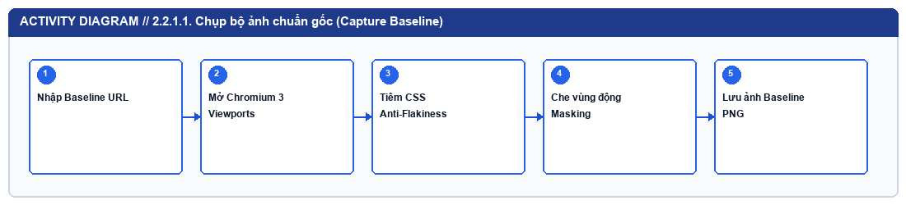
*Hình 2.1.1: Biểu đồ hoạt động — 2.2.1.1. Luồng hoạt động Chụp bộ ảnh chuẩn gốc (Capture Baseline)*


#### 2.2.1.2. Luồng hoạt động Thực thi Phiên kiểm thử so khớp (Run Visual Test)

Người dùng bấm 'Chạy So Khớp Kiểm Thử' → Kiểm tra đã có ảnh Baseline chưa (nếu chưa: tự động chụp Baseline từ baseline_url) → Khởi chạy Chromium chụp 3 ảnh Current từ Current URL → Lưu vào storage/runs/{run_id}/currents/ → Gọi DiffEngine.compare() cho từng màn hình → Tổng hợp số màn hình Đạt/Lỗi → Sinh báo cáo report.html → Trả kết quả về Bàn Kiểm Định.


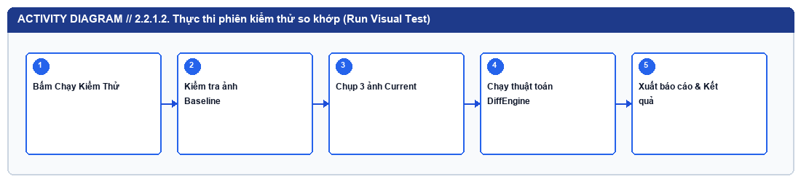
*Hình 2.1.2: Biểu đồ hoạt động — 2.2.1.2. Luồng hoạt động Thực thi Phiên kiểm thử so khớp (Run Visual Test)*


#### 2.2.1.3. Luồng hoạt động Chuẩn hóa kích thước ảnh (Canvas Auto-Padding)

Đọc ảnh Baseline (W1 × H1) và ảnh Current (W2 × H2) → Kiểm tra (W1 == W2 và H1 == H2) → Nếu bằng nhau: giữ nguyên ma trận RGB → Nếu khác nhau: Tạo khung ảnh nền trung tính kích thước W_max = max(W1, W2), H_max = max(H1, H2) → Dán ảnh gốc vào tọa độ (0,0) → Chuyển sang bước tính khoảng cách màu.


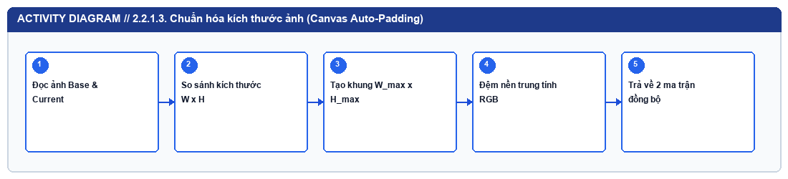
*Hình 2.1.3: Biểu đồ hoạt động — 2.2.1.3. Luồng hoạt động Chuẩn hóa kích thước ảnh (Canvas Auto-Padding)*


#### 2.2.1.4. Luồng hoạt động Tính Perceptual Diff & Lọc răng cưa 3×3

Nhận hai ma trận RGB đã chuẩn hóa → Tính khoảng cách Euclidean chuẩn hóa ΔE(x,y) trên toàn bộ điểm ảnh → Đánh dấu mặt nạ thô các điểm có ΔE > 0.1 → Quét cửa sổ trượt 3×3 kiểm tra độ tương phản cục bộ ΔL_local → Loại bỏ các pixel nội suy viền chữ (Anti-Aliasing) → Thu được mặt nạ lỗi thực sự M_final.


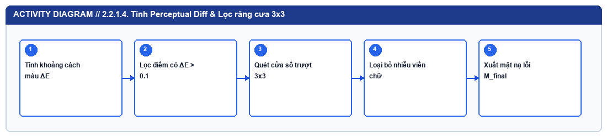
*Hình 2.1.4: Biểu đồ hoạt động — 2.2.1.4. Luồng hoạt động Tính Perceptual Diff & Lọc răng cưa 3×3*


#### 2.2.1.5. Luồng hoạt động Gom cụm vùng lỗi OpenCV & Chẩn đoán ngữ nghĩa

Nhận mặt nạ lỗi M_final → Thực hiện phép giãn nở cv2.dilate (kernel 15×15, 2 iterations) → Tìm đường bao cv2.findContours → Lọc bỏ vùng nhiễu có diện tích < 25px² → Gộp các khung chữ nhật nằm gần nhau (< 18px) → Phân tích độ lệch màu sắc và vị trí trọng tâm tại từng khung → Xuất danh sách BoundingBox kèm mô tả tiếng Việt.


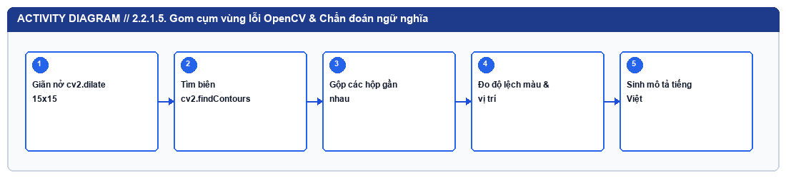
*Hình 2.1.5: Biểu đồ hoạt động — 2.2.1.5. Luồng hoạt động Gom cụm vùng lỗi OpenCV & Chẩn đoán ngữ nghĩa*


#### 2.2.1.6. Luồng hoạt động Đối chiếu trực quan 5 chế độ trên Bàn Kiểm Định

Nhận dữ liệu phiên chạy activeRun → Người dùng chọn màn hình (Desktop/Tablet/Mobile) → Chọn chế độ xem: [Thanh Trượt: cập nhật clip-path theo tọa độ chuột] / [3 Cột: hiển thị song song + vẽ lớp phủ SVG Bounding Box] / [Chớp Tắt: đảo ảnh theo chu kỳ 500ms] / [Mờ Đè Lớp: trộn opacity] / [Kính Lúp: tính tọa độ tương đối và phóng đại 2x-4x].


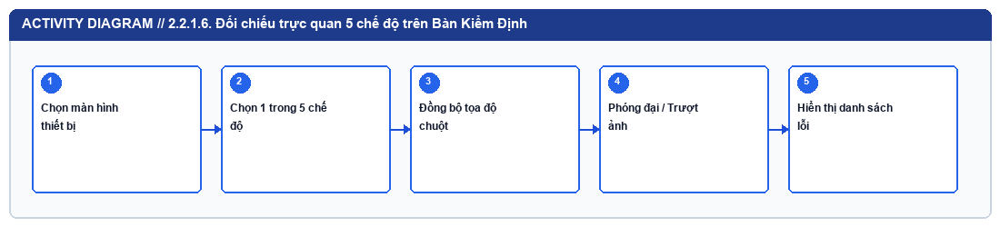
*Hình 2.1.6: Biểu đồ hoạt động — 2.2.1.6. Luồng hoạt động Đối chiếu trực quan 5 chế độ trên Bàn Kiểm Định*


#### 2.2.1.7. Luồng hoạt động Phê duyệt ảnh hiện tại làm Baseline mới (Approve Baseline)

Người dùng bấm 'Duyệt Làm Ảnh Chuẩn Mới' → Xác nhận hộp thoại → Gọi POST /api/runs/{run_id}/approve → Sao chép đè current_<vp>.png sang storage/baselines/{suite_id}/baseline_<vp>.png → Đặt lại diff_ratio = 0.0%, ssim_score = 1.0, status = PASSED → Cập nhật giao diện.


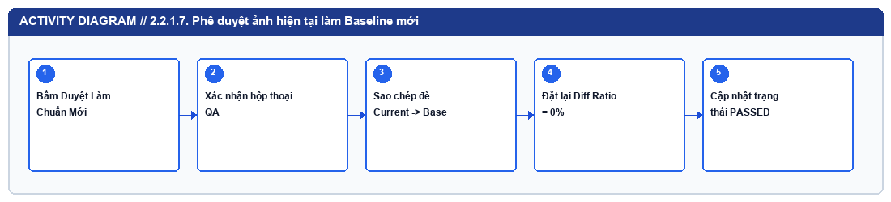
*Hình 2.1.7: Biểu đồ hoạt động — 2.2.1.7. Luồng hoạt động Phê duyệt ảnh hiện tại làm Baseline mới (Approve Baseline)*


#### 2.2.1.8. Luồng hoạt động Kiểm thử trực tiếp kho mã nguồn GitHub (GitHub Repo Runner)

Người dùng nhập link GitHub Repo tại Tab 03 → Hệ thống phân tách owner/repo → Thực thi git clone --depth 25 (hoặc git fetch nếu đã có trong bộ đệm) → Tìm thư mục giao diện (frontend/dist, dist, index.html) → Khởi tạo EphemeralStaticServer trên cổng nội bộ ngẫu nhiên → Chụp ảnh Baseline và Current (theo 2 Commit hoặc tiêm CSS lỗi) → Chạy DiffEngine → Hiển thị Terminal + 3 ảnh kết quả.


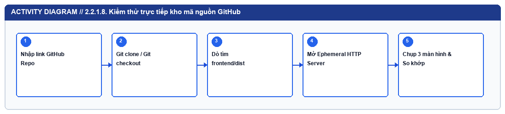
*Hình 2.1.8: Biểu đồ hoạt động — 2.2.1.8. Luồng hoạt động Kiểm thử trực tiếp kho mã nguồn GitHub (GitHub Repo Runner)*


#### 2.2.1.9. Luồng hoạt động Cổng kiểm duyệt dòng lệnh Headless CLI (cli.py)

Đọc tham số dòng lệnh (--mode, --suite-id, --threshold, --output-html) → Khởi tạo luồng kiểm thử bất đồng bộ → Xuất bảng kết quả ASCII ra stdout → Ghi báo cáo HTML/JSON → Kiểm tra overall_status: nếu PASSED trả về sys.exit(0), nếu FAILED trả về sys.exit(1).


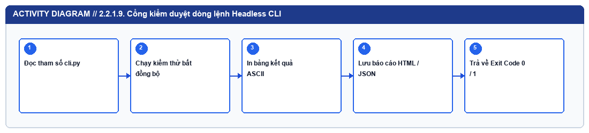
*Hình 2.1.9: Biểu đồ hoạt động — 2.2.1.9. Luồng hoạt động Cổng kiểm duyệt dòng lệnh Headless CLI (cli.py)*


#### 2.2.1.10. Luồng hoạt động Đường ống tự động GitHub Actions CI/CD

Sự kiện git push / pull_request trên nhánh main → Khởi tạo máy ảo ubuntu-latest → Cài đặt Python 3.11, OpenCV, Playwright Chromium → Chạy test_engines.py → Chạy Gate 1 (Zero-Diff: cli.py --mode pass) → Chạy Gate 2 (Regression Detection: cli.py --mode regression) → Xuất bảng tổng kết lên GitHub Job Summary & tải gói ảnh lên Artifacts.


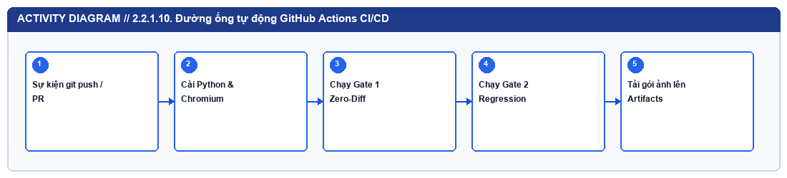
*Hình 2.1.10: Biểu đồ hoạt động — 2.2.1.10. Luồng hoạt động Đường ống tự động GitHub Actions CI/CD*


### 2.2.2 Phân Tích Trình Tự Tương Tác (Sequence Diagrams)

Bảng dưới đây mô tả trình tự trao đổi thông điệp theo thời gian thực giữa các đối tượng thành phần (Actor → React UI / CLI → FastAPI Router → Service Engine → Storage) cho 10 kịch bản tương tác chính:


| Mã biểu đồ | Tên kịch bản tương tác | Trình tự truyền thông điệp (Message Sequence) |
| --- | --- | --- |
| SD01 | SD01 — Tạo Suite & Chụp Baseline | QA → React UI: Bấm 'Chụp Ảnh Gốc' | React UI → SuitesRouter: POST /api/suites/{id}/capture-baseline | SuitesRouter → BrowserEngine: capture_screenshot(url, vp) | BrowserEngine → Chromium: goto(url) + add_style_tag() + screenshot() | SuitesRouter → StorageManager: update_suite_has_baseline(True) | SuitesRouter → React UI: 200 OK (BaselineCaptureResponse). |
| SD02 | SD02 — Chạy Phiên Kiểm Thử So Khớp | QA → React UI: Bấm 'Chạy So Khớp Kiểm Thử' | React UI → SuitesRouter: POST /api/suites/{id}/run | SuitesRouter → TestRunner: execute_test_run(suite_id) | TestRunner → BrowserEngine: Chụp 3 ảnh Current | TestRunner → DiffEngine: compare(baseline, current, diff_out) | TestRunner → ReportGenerator: generate_html_report() | TestRunner → StorageManager: save_run(run_record) | SuitesRouter → React UI: 200 OK (TestRunResponse). |
| SD03 | SD03 — Phân Tích Điểm Ảnh Trong DiffEngine | TestRunner → DiffEngine: compare() | DiffEngine → DiffEngine: _load_and_normalize_images() | DiffEngine → NumPy: Tính ΔE trên ma trận float32 | DiffEngine → DiffEngine: _detect_anti_aliasing(3x3) | DiffEngine → scikit-image: structural_similarity(gray_b, gray_c) | DiffEngine → OpenCV: dilate() + findContours() | DiffEngine → TestRunner: Dict kết quả & BoundingBoxes. |
| SD04 | SD04 — Tương Tác Kính Lúp & Thanh Trượt | QA → DiffViewer: Chọn chế độ 'Kính Lúp' / 'Thanh Trượt' | QA → MagnifierCompare: Di chuyển chuột (onMouseMove) | MagnifierCompare → MagnifierCompare: Tính tọa độ chuẩn hóa (relX, relY) | MagnifierCompare → DOM Canvas: Cập nhật backgroundPosition phóng đại 2x/3x/4x đồng bộ trên cả 3 khung ảnh Baseline, Current, Diff. |
| SD05 | SD05 — Phê Duyệt Ảnh Mới Làm Baseline | QA → DiffViewer: Bấm 'Duyệt Làm Ảnh Chuẩn Mới' | DiffViewer → RunsRouter: POST /api/runs/{run_id}/approve | RunsRouter → StorageManager: approve_run_as_baseline(run_id) | StorageManager → FileSystem: shutil.copy2(current_path, baseline_path) | StorageManager → runs.json: Cập nhật status=PASSED, diff_ratio=0 | RunsRouter → DiffViewer: 200 OK. |
| SD06 | SD06 — Truy Vấn Biểu Đồ Xu Hướng & Lọc Lịch Sử | QA → App.jsx: Chuyển sang Tab 02 | App.jsx → RunsRouter: GET /api/runs | RunsRouter → StorageManager: list_runs() | App.jsx → TrendChart: Truyền mảng runs | TrendChart → SVG DOM: Vẽ biểu đồ Avg Diff % & Avg SSIM % | QA → App.jsx: Nhấp vào 1 dòng lịch sử | App.jsx → RunsRouter: GET /api/runs/{id} → Mở lại ảnh kiểm định. |
| SD07 | SD07 — Xuất Báo Cáo HTML Độc Lập Base64 | QA → App.jsx: Bấm 'Mở Báo Cáo HTML' | Trình duyệt → RunsRouter: GET /api/runs/{run_id}/report | RunsRouter → FileSystem: Kiểm tra report.html (nếu chưa có gọi ReportGenerator.generate_html_report mã hóa ảnh PNG sang chuỗi data:image/png;base64) | RunsRouter → Trình duyệt: Trả về FileResponse(report.html). |
| SD08 | SD08 — Đồng Bộ Trạng Thái GitHub Actions (Tab 03) | QA → CiCdPanel: Nhập link GitHub & bấm 'Nạp Dự Án' | CiCdPanel → GitHub REST API: GET /repos/{slug}/actions/runs & GET /repos/{slug}/commits | GitHub API → CiCdPanel: Trả về danh sách Workflow Runs & 10 Commits gần nhất | QA → CiCdPanel: Chọn 1 Run | CiCdPanel → GitHub API: GET /actions/runs/{id}/jobs → Hiển thị các bước. |
| SD09 | SD09 — Clone & Kiểm Thử Kho GitHub Bất Kỳ (Tab 03) | QA → CiCdPanel: Bấm 'Chạy Kiểm Thử Dự Án Ngay' | CiCdPanel → SuitesRouter: POST /api/suites/run-github | SuitesRouter → GitHubRunner: execute_github_repo_visual_test() | GitHubRunner → Git CLI: git clone / git checkout | GitHubRunner → EphemeralStaticServer: Phục vụ thư mục dist trên cổng cục bộ | GitHubRunner → BrowserEngine & DiffEngine: Chụp & so khớp 3 màn hình | SuitesRouter → CiCdPanel: Trả về kết quả & hiển thị 3 ảnh thực tế. |
| SD10 | SD10 — Cổng Kiểm Duyệt Dòng Lệnh CLI (cli.py) | CI/CD Pipeline → cli.py: Gọi lệnh kèm tham số | cli.py → EphemeralDemoServer: Mở cổng cục bộ phục vụ demo_sites | cli.py → TestRunner: execute_test_run() | TestRunner → cli.py: Trả về run_record | cli.py → FileSystem: Lưu báo cáo HTML/JSON & ghi GITHUB_STEP_SUMMARY | cli.py → OS Kernel: sys.exit(0) hoặc sys.exit(1). |

*Bảng 2.3: Đặc tả 10 biểu đồ tuần tự (Sequence Diagrams) của hệ thống*


#### 2.2.2.1. Biểu đồ tuần tự SD01 — Tạo Suite & Chụp Baseline

QA → React UI: Bấm 'Chụp Ảnh Gốc' | React UI → SuitesRouter: POST /api/suites/{id}/capture-baseline | SuitesRouter → BrowserEngine: capture_screenshot(url, vp) | BrowserEngine → Chromium: goto(url) + add_style_tag() + screenshot() | SuitesRouter → StorageManager: update_suite_has_baseline(True) | SuitesRouter → React UI: 200 OK (BaselineCaptureResponse).


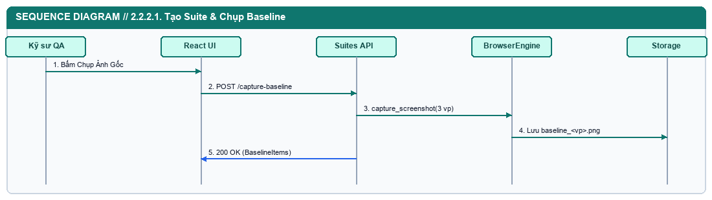
*Hình 2.2.1: Biểu đồ tuần tự — SD01 — Tạo Suite & Chụp Baseline*


#### 2.2.2.2. Biểu đồ tuần tự SD02 — Chạy Phiên Kiểm Thử So Khớp

QA → React UI: Bấm 'Chạy So Khớp Kiểm Thử' | React UI → SuitesRouter: POST /api/suites/{id}/run | SuitesRouter → TestRunner: execute_test_run(suite_id) | TestRunner → BrowserEngine: Chụp 3 ảnh Current | TestRunner → DiffEngine: compare(baseline, current, diff_out) | TestRunner → ReportGenerator: generate_html_report() | TestRunner → StorageManager: save_run(run_record) | SuitesRouter → React UI: 200 OK (TestRunResponse).


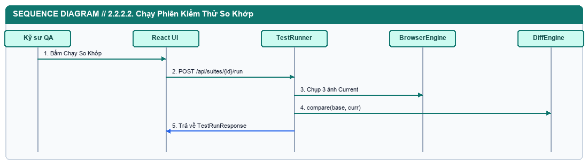
*Hình 2.2.2: Biểu đồ tuần tự — SD02 — Chạy Phiên Kiểm Thử So Khớp*


#### 2.2.2.3. Biểu đồ tuần tự SD03 — Phân Tích Điểm Ảnh Trong DiffEngine

TestRunner → DiffEngine: compare() | DiffEngine → DiffEngine: _load_and_normalize_images() | DiffEngine → NumPy: Tính ΔE trên ma trận float32 | DiffEngine → DiffEngine: _detect_anti_aliasing(3x3) | DiffEngine → scikit-image: structural_similarity(gray_b, gray_c) | DiffEngine → OpenCV: dilate() + findContours() | DiffEngine → TestRunner: Dict kết quả & BoundingBoxes.


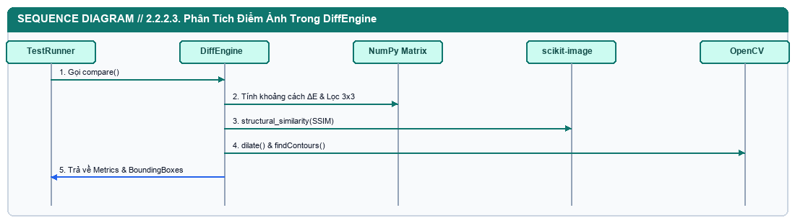
*Hình 2.2.3: Biểu đồ tuần tự — SD03 — Phân Tích Điểm Ảnh Trong DiffEngine*


#### 2.2.2.4. Biểu đồ tuần tự SD04 — Tương Tác Kính Lúp & Thanh Trượt

QA → DiffViewer: Chọn chế độ 'Kính Lúp' / 'Thanh Trượt' | QA → MagnifierCompare: Di chuyển chuột (onMouseMove) | MagnifierCompare → MagnifierCompare: Tính tọa độ chuẩn hóa (relX, relY) | MagnifierCompare → DOM Canvas: Cập nhật backgroundPosition phóng đại 2x/3x/4x đồng bộ trên cả 3 khung ảnh Baseline, Current, Diff.


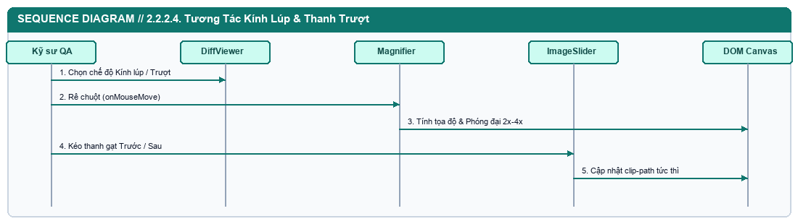
*Hình 2.2.4: Biểu đồ tuần tự — SD04 — Tương Tác Kính Lúp & Thanh Trượt*


#### 2.2.2.5. Biểu đồ tuần tự SD05 — Phê Duyệt Ảnh Mới Làm Baseline

QA → DiffViewer: Bấm 'Duyệt Làm Ảnh Chuẩn Mới' | DiffViewer → RunsRouter: POST /api/runs/{run_id}/approve | RunsRouter → StorageManager: approve_run_as_baseline(run_id) | StorageManager → FileSystem: shutil.copy2(current_path, baseline_path) | StorageManager → runs.json: Cập nhật status=PASSED, diff_ratio=0 | RunsRouter → DiffViewer: 200 OK.


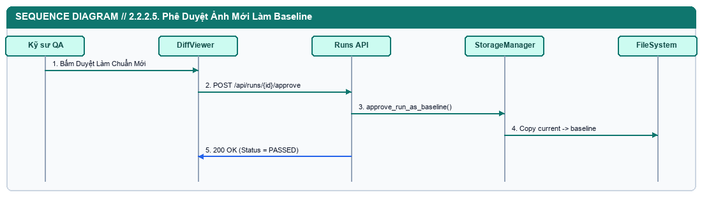
*Hình 2.2.5: Biểu đồ tuần tự — SD05 — Phê Duyệt Ảnh Mới Làm Baseline*


#### 2.2.2.6. Biểu đồ tuần tự SD06 — Truy Vấn Biểu Đồ Xu Hướng & Lọc Lịch Sử

QA → App.jsx: Chuyển sang Tab 02 | App.jsx → RunsRouter: GET /api/runs | RunsRouter → StorageManager: list_runs() | App.jsx → TrendChart: Truyền mảng runs | TrendChart → SVG DOM: Vẽ biểu đồ Avg Diff % & Avg SSIM % | QA → App.jsx: Nhấp vào 1 dòng lịch sử | App.jsx → RunsRouter: GET /api/runs/{id} → Mở lại ảnh kiểm định.


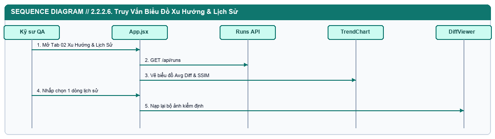
*Hình 2.2.6: Biểu đồ tuần tự — SD06 — Truy Vấn Biểu Đồ Xu Hướng & Lọc Lịch Sử*


#### 2.2.2.7. Biểu đồ tuần tự SD07 — Xuất Báo Cáo HTML Độc Lập Base64

QA → App.jsx: Bấm 'Mở Báo Cáo HTML' | Trình duyệt → RunsRouter: GET /api/runs/{run_id}/report | RunsRouter → FileSystem: Kiểm tra report.html (nếu chưa có gọi ReportGenerator.generate_html_report mã hóa ảnh PNG sang chuỗi data:image/png;base64) | RunsRouter → Trình duyệt: Trả về FileResponse(report.html).


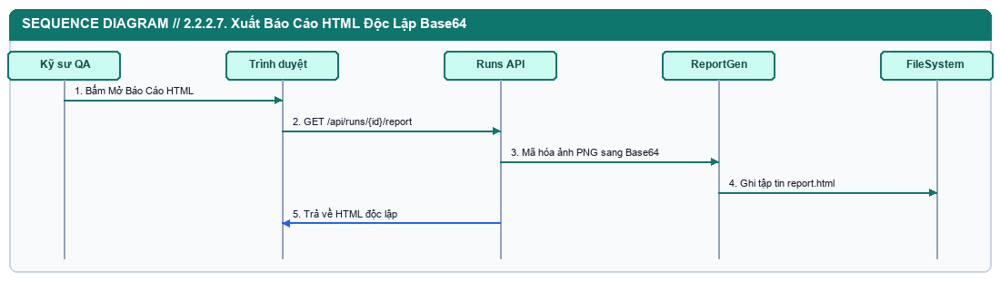
*Hình 2.2.7: Biểu đồ tuần tự — SD07 — Xuất Báo Cáo HTML Độc Lập Base64*


#### 2.2.2.8. Biểu đồ tuần tự SD08 — Đồng Bộ Trạng Thái GitHub Actions (Tab 03)

QA → CiCdPanel: Nhập link GitHub & bấm 'Nạp Dự Án' | CiCdPanel → GitHub REST API: GET /repos/{slug}/actions/runs & GET /repos/{slug}/commits | GitHub API → CiCdPanel: Trả về danh sách Workflow Runs & 10 Commits gần nhất | QA → CiCdPanel: Chọn 1 Run | CiCdPanel → GitHub API: GET /actions/runs/{id}/jobs → Hiển thị các bước.


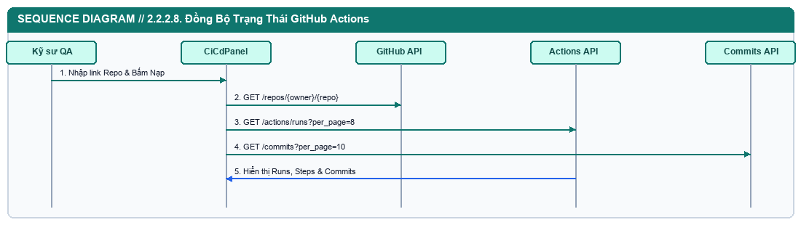
*Hình 2.2.8: Biểu đồ tuần tự — SD08 — Đồng Bộ Trạng Thái GitHub Actions (Tab 03)*


#### 2.2.2.9. Biểu đồ tuần tự SD09 — Clone & Kiểm Thử Kho GitHub Bất Kỳ (Tab 03)

QA → CiCdPanel: Bấm 'Chạy Kiểm Thử Dự Án Ngay' | CiCdPanel → SuitesRouter: POST /api/suites/run-github | SuitesRouter → GitHubRunner: execute_github_repo_visual_test() | GitHubRunner → Git CLI: git clone / git checkout | GitHubRunner → EphemeralStaticServer: Phục vụ thư mục dist trên cổng cục bộ | GitHubRunner → BrowserEngine & DiffEngine: Chụp & so khớp 3 màn hình | SuitesRouter → CiCdPanel: Trả về kết quả & hiển thị 3 ảnh thực tế.


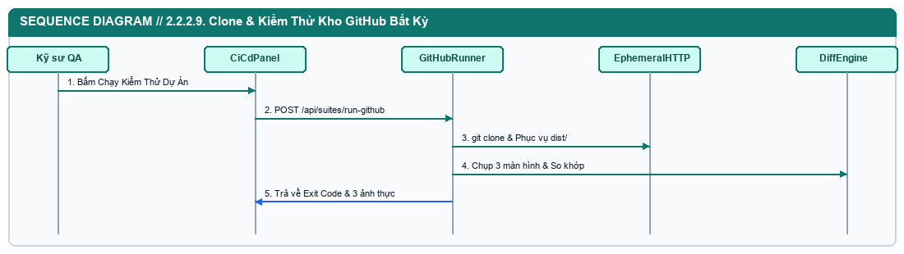
*Hình 2.2.9: Biểu đồ tuần tự — SD09 — Clone & Kiểm Thử Kho GitHub Bất Kỳ (Tab 03)*


#### 2.2.2.10. Biểu đồ tuần tự SD10 — Cổng Kiểm Duyệt Dòng Lệnh CLI (cli.py)

CI/CD Pipeline → cli.py: Gọi lệnh kèm tham số | cli.py → EphemeralDemoServer: Mở cổng cục bộ phục vụ demo_sites | cli.py → TestRunner: execute_test_run() | TestRunner → cli.py: Trả về run_record | cli.py → FileSystem: Lưu báo cáo HTML/JSON & ghi GITHUB_STEP_SUMMARY | cli.py → OS Kernel: sys.exit(0) hoặc sys.exit(1).


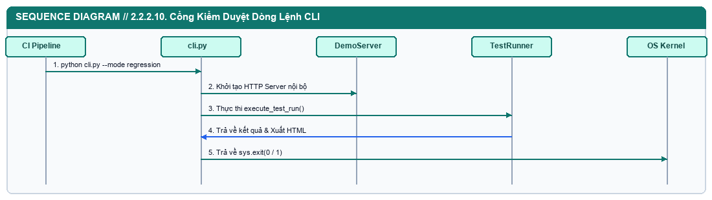
*Hình 2.2.10: Biểu đồ tuần tự — SD10 — Cổng Kiểm Duyệt Dòng Lệnh CLI (cli.py)*


## 2.3 Thiết Kế Kiến Trúc 3 Lớp (Three-Tier Architecture)

Hệ thống được thiết kế theo mô hình Kiến trúc 3 Lớp (Three-Tier Architecture) tách biệt rõ ràng giữa Lớp Trình bày (Presentation Layer), Lớp Xử lý Nghiệp vụ & Thị giác Máy tính (Business Logic Layer) và Lớp Lưu trữ Dữ liệu (Data & Artifact Storage Layer):


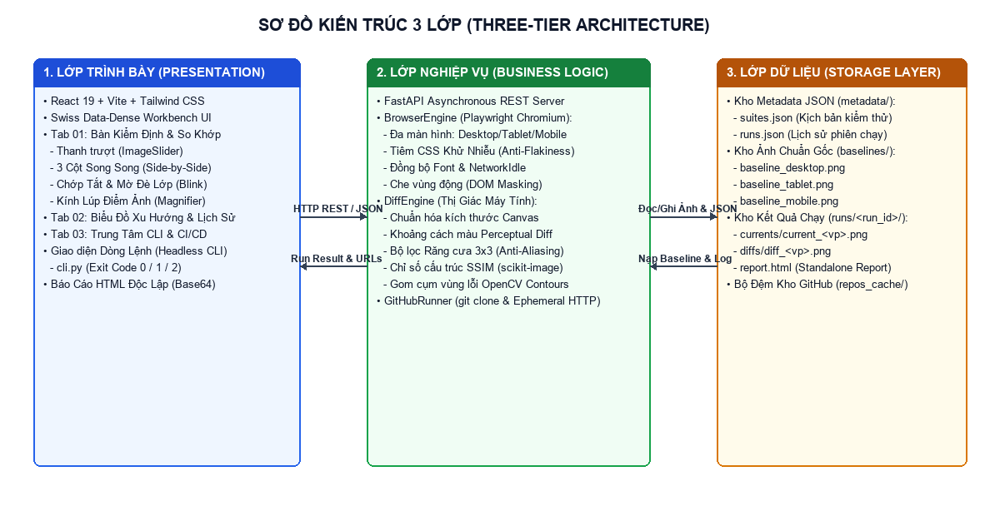
*Hình 2.2: Sơ đồ Kiến trúc 3 Lớp (Three-Tier Architecture) của hệ thống PixelPulse Visual QA*


### 2.3.1 Lớp Trình Bày (Presentation Layer)


| Thành phần (Component / File) | Công nghệ | Trách nhiệm hiển thị & tương tác |
| --- | --- | --- |
| App.jsx | React 19 + Tailwind CSS | Khung bố cục chính, quản lý điều hướng 3 Tab (Bàn Kiểm Định, Xu Hướng & Lịch Sử, Tích Hợp CLI & CI/CD), chuyển đổi chế độ Sáng/Tối và bảng nhật ký lịch sử. |
| TestRunnerForm.jsx | React 19 | Biểu mẫu cấu hình URL chuẩn gốc, URL hiện tại, chọn thiết bị, nạp cấu hình mẫu và 2 nút hành động tách biệt: Chụp Ảnh Gốc & Chạy So Khớp. |
| BaselineViewer.jsx | React 19 | Hiển thị lưới 3 bức ảnh chuẩn gốc (Baseline) vừa chụp kèm độ phân giải (px) và dung lượng (KB). |
| MetricsCard.jsx | React 19 | Hiển thị 4 thẻ chỉ số định lượng dạng bảng số (tabular-nums): Phán quyết tổng thể, Tỷ lệ màn hình đạt, Tỷ lệ sai lệch cao nhất (%) và Điểm cấu trúc SSIM. |
| DiffViewer.jsx | React 19 | Bàn kiểm định trung tâm chứa bộ chuyển đổi 3 màn hình, 5 chế độ soi lỗi trực quan, nút Duyệt làm ảnh chuẩn mới và bảng danh sách các vùng lỗi OpenCV. |
| ImageSlider.jsx / BlinkCompare.jsx / MagnifierCompare.jsx | React 19 + HTML5 | Các thành phần tương tác quang học chuyên biệt: kéo thanh trượt Trước/Sau, chớp tắt theo chu kỳ, hòa trộn mờ Onion Skin và kính lúp phóng đại 2×/3×/4×. |
| TrendChart.jsx | React 19 | Biểu đồ cột đôi thống kê xu hướng sai lệch điểm ảnh (Avg Diff %) và độ tương đồng cấu trúc (Avg SSIM %) qua 10 phiên chạy gần nhất. |
| CiCdPanel.jsx | React 19 + GitHub API | Trung tâm kết nối GitHub Actions, nạp lịch sử Commit của kho GitHub bất kỳ và kích hoạt kiểm thử hồi quy trực tiếp trên kho GitHub đó. |

*Bảng 2.4: Các thành phần thuộc Lớp Trình Bày (Presentation Layer)*


### 2.3.2 Lớp Xử Lý Nghiệp Vụ & Thị Giác Máy Tính (Business Logic Layer)


| Module / Dịch vụ | Đường dẫn mã nguồn | Trách nhiệm xử lý nghiệp vụ cốt lõi |
| --- | --- | --- |
| Suites API & Runs API | backend/app/api/suites.py, runs.py | Cung cấp 11 RESTful API endpoints, kiểm tra dữ liệu đầu vào qua Pydantic v2 và điều phối luồng xử lý bất đồng bộ. |
| BrowserEngine | backend/app/services/browser_engine.py | Quản lý vòng đời trình duyệt Playwright Headless Chromium, giả lập 3 độ phân giải thiết bị, tiêm CSS Anti-Flakiness và che vùng động DOM Masking. |
| DiffEngine | backend/app/services/diff_engine.py | Thực thi toàn bộ chuỗi thuật toán Thị giác máy tính: chuẩn hóa kích thước ảnh, tính Perceptual Diff, lọc răng cưa chữ 3×3, tính SSIM, gom cụm vùng lỗi OpenCV và chẩn đoán ngữ nghĩa tiếng Việt. |
| TestRunner | backend/app/services/test_runner.py | Điều phối luồng kiểm thử chuẩn giữa 2 đường dẫn URL (tự động kiểm tra/khởi tạo Baseline, chụp Current, gọi DiffEngine và lưu báo cáo). |
| GitHubRunner | backend/app/services/github_runner.py | Tự động git clone / git fetch kho mã nguồn GitHub công khai bất kỳ, tìm thư mục giao diện web, mở máy chủ EphemeralStaticServer và chạy kiểm thử giữa 2 bản Commit hoặc giả lập lỗi CSS. |
| ReportGenerator | backend/app/services/reporter.py | Tạo tập tin báo cáo HTML độc lập (report.html) với toàn bộ hình ảnh được mã hóa Base64 nhúng trực tiếp bên trong. |
| CLI Gatekeeper | backend/app/cli.py, cli.py | Giao diện dòng lệnh không giao diện phục vụ đường ống CI/CD, xuất bảng tổng kết ASCII, ghi GitHub Step Summary và trả về Exit Code chuẩn (0/1/2). |

*Bảng 2.5: Các thành phần thuộc Lớp Xử Lý Nghiệp Vụ (Business Logic Layer)*


### 2.3.3 Lớp Lưu Trữ Dữ Liệu (Data & Artifact Storage Layer)


| Thành phần lưu trữ | Đường dẫn vật lý | Cấu trúc và mục đích lưu trữ |
| --- | --- | --- |
| Kho kịch bản (Suites Store) | backend/storage/metadata/suites.json | Lưu danh sách cấu hình các bộ kịch bản kiểm thử (URL gốc, URL hiện tại, viewports, ngưỡng dung sai, danh sách selector che vùng động). |
| Kho lịch sử chạy (Runs Store) | backend/storage/metadata/runs.json | Lưu toàn bộ lịch sử các phiên chạy kiểm thử kèm thông số chi tiết của từng màn hình và danh sách tọa độ các vùng lỗi BoundingBox. |
| Kho ảnh chuẩn gốc (Baselines) | backend/storage/baselines/<suite_id>/ | Lưu trữ bền vững 3 tập tin ảnh chuẩn gốc: baseline_desktop.png, baseline_tablet.png, baseline_mobile.png. |
| Kho kết quả phiên chạy (Run Artifacts) | backend/storage/runs/<run_id>/ | Mỗi phiên chạy có thư mục riêng chứa currents/current_<vp>.png, diffs/diff_<vp>.png và tập tin báo cáo độc lập report.html. |
| Bộ đệm kho GitHub (Repos Cache) | backend/storage/repos_cache/ | Lưu bản sao cục bộ các kho mã nguồn GitHub được clone về để tăng tốc độ chuyển đổi nhánh/commit ở các lần kiểm thử tiếp theo. |

*Bảng 2.6: Các thành phần thuộc Lớp Lưu Trữ Dữ Liệu (Storage Layer)*


## 2.4 Thiết Kế Cấu Trúc Dữ Liệu & Lược Đồ Thực Thể (Data Schema)

Hệ thống sử dụng cơ chế lưu trữ siêu dữ liệu định dạng JSON có cấu trúc chặt chẽ được kiểm duyệt bởi Pydantic v2 kết hợp với hệ thống lưu trữ tập tin hình ảnh phân cấp. Hình dưới đây minh họa mối quan hệ giữa các thực thể dữ liệu chính:


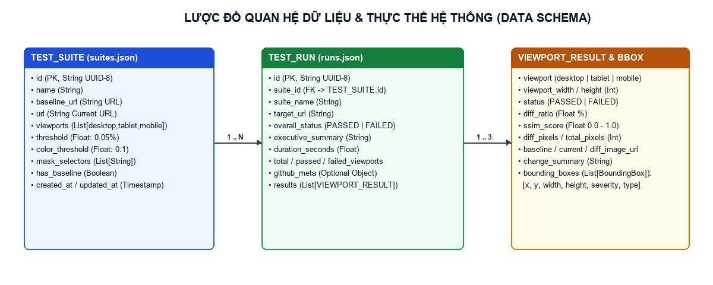
*Hình 2.3: Lược đồ quan hệ dữ liệu giữa TestSuite, TestRun, ViewportResult và BoundingBox*


### 2.4.1 Cấu Trúc Thực Thể Bộ Kịch Bản Kiểm Thử (TestSuite Schema)


| Tên trường | Kiểu dữ liệu | Ràng buộc / Mặc định | Mô tả ý nghĩa |
| --- | --- | --- | --- |
| id | String (UUID-8) | Primary Key, Not Null | Mã định danh duy nhất gồm 8 ký tự thập lục phân của bộ kịch bản. |
| name | String | Not Null | Tên gợi nhớ của bộ kịch bản kiểm thử (ví dụ: 'GitHub CI: mchienc/software-testing'). |
| baseline_url | String (URL) | Optional | Đường dẫn URL của phiên bản chuẩn gốc dùng để chụp ảnh Baseline. |
| url | String (URL) | Not Null | Đường dẫn URL của phiên bản hiện tại cần kiểm tra đối chiếu. |
| viewports | List[String] | Default: ['desktop','tablet','mobile'] | Danh sách các độ phân giải thiết bị cần chụp và kiểm định. |
| threshold | Float | Default: 0.05 (%) | Ngưỡng tỷ lệ phần trăm điểm ảnh sai lệch tối đa cho phép để đạt PASSED. |
| color_threshold | Float | Default: 0.1 | Hệ số dung sai khoảng cách màu tri giác γ (từ 0.0 đến 1.0). |
| mask_selectors | List[String] | Default: ['.timestamp'] | Danh sách các CSS Selectors của phần tử động cần che trước khi chụp. |
| has_baseline | Boolean | Default: False | Cờ đánh dấu kịch bản này đã có bộ ảnh chuẩn gốc trên đĩa hay chưa. |
| created_at / updated_at | String (DateTime) | ISO Format | Thời điểm khởi tạo và cập nhật gần nhất của bộ kịch bản. |

*Bảng 2.7: Đặc tả cấu trúc dữ liệu thực thể TestSuite*


### 2.4.2 Cấu Trúc Thực Thể Phiên Chạy Kiểm Thử (TestRun & ViewportResult Schema)


| Tên trường | Kiểu dữ liệu | Thuộc thực thể | Mô tả ý nghĩa |
| --- | --- | --- | --- |
| id | String (UUID-8) | TestRun (PK) | Mã định danh duy nhất của phiên chạy kiểm thử. |
| suite_id | String (UUID-8) | TestRun (FK) | Khóa ngoại tham chiếu tới bộ kịch bản TestSuite.id. |
| overall_status | String Enum | TestRun | Kết quả tổng thể của phiên chạy: PASSED (nếu tất cả màn hình đạt) hoặc FAILED. |
| executive_summary | String | TestRun | Bản tóm tắt chẩn đoán tổng quan bằng tiếng Việt về kết quả của phiên chạy. |
| duration_seconds | Float | TestRun | Tổng thời gian thực thi phiên kiểm thử tính bằng giây. |
| github_meta | Dict[String, Any] | TestRun (Optional) | Lưu thông tin kho GitHub (repo_slug, baseline_commit, current_commit, served_web_root). |
| viewport | String | ViewportResult | Định danh màn hình: desktop (1920×1080), tablet (768×1024) hoặc mobile (375×812). |
| diff_ratio | Float (%) | ViewportResult | Tỷ lệ phần trăm điểm ảnh sai lệch trên màn hình đó (0.0000% đến 100.0%). |
| ssim_score | Float | ViewportResult | Chỉ số tương đồng cấu trúc SSIM trên màn hình đó (0.0000 đến 1.0000). |
| diff_pixels / total_pixels | Integer | ViewportResult | Số lượng điểm ảnh bị lỗi tuyệt đối và tổng số điểm ảnh của bức ảnh chuẩn hóa. |
| baseline / current / diff_image_url | String (Path) | ViewportResult | Đường dẫn tĩnh phục vụ truy cập trực tiếp 3 bức ảnh qua giao thức HTTP. |
| bounding_boxes | List[BoundingBox] | ViewportResult | Danh sách các khung chữ nhật khoanh vùng khiếm khuyết trên màn hình đó. |

*Bảng 2.8: Đặc tả cấu trúc dữ liệu thực thể TestRun và ViewportResult*


### 2.4.3 Cấu Trúc Thực Thể Vùng Khiếm Khuyết Giao Diện (BoundingBox Schema)


| Tên trường | Kiểu dữ liệu | Mô tả ý nghĩa kỹ thuật |
| --- | --- | --- |
| x, y | Integer (px) | Tọa độ góc trên bên trái (Top-Left X, Y) của khung chữ nhật bao quanh vùng lỗi. |
| width, height | Integer (px) | Chiều rộng và chiều cao (tính bằng pixel) của vùng giao diện bị biến dạng. |
| region_name | String | Vị trí tương đối của vùng lỗi trên bố cục trang (ví dụ: 'Đầu trang (Header / Navigation)', 'Khu vực chính (Hero / CTA)'). |
| defect_type | String | Phân loại lỗi tự động: 'Sai Màu Sắc', 'Lệch Bố Cục (Layout Shift)' hoặc 'Thay Đổi Nội Dung / Kích Thước'. |
| severity | String Enum | Mức độ nghiêm trọng dựa trên diện tích và cường độ biến đổi: HIGH (Nghiêm trọng), MEDIUM (Trung bình), LOW (Thấp). |
| description | String | Câu mô tả chẩn đoán chi tiết bằng tiếng Việt về sự thay đổi màu sắc hoặc độ dịch chuyển bên trong vùng lỗi. |

*Bảng 2.9: Đặc tả cấu trúc dữ liệu thực thể vùng lỗi BoundingBox*


---


# CHƯƠNG 3: XÂY DỰNG HỆ THỐNG, GIAO DIỆN & THỰC NGHIỆM KIỂM THỬ


## 3.1 Kiến Trúc Mã Nguồn & Tổ Chức Thư Mục

Dự án được tổ chức theo cấu trúc tách biệt rõ ràng giữa Backend (Python FastAPI + Playwright + OpenCV), Frontend (React 19 + Vite + Tailwind CSS), Công cụ dòng lệnh CLI (cli.py) và Đường ống tự động GitHub Actions (.github/workflows/visual-regression.yml):

**Cấu trúc thư mục tổng thể của dự án:**

```text
software_testing/
├── .github/workflows/visual-regression.yml  # Pipeline GitHub Actions CI/CD tự động
├── cli.py                                   # Điểm vào CLI Gatekeeper tại thư mục gốc
├── README.md                                # Tài liệu hướng dẫn dự án
└── visual-regression-tool/
    ├── backend/
    │   ├── app/
    │   │   ├── api/                         # suites.py, runs.py (11 REST Endpoints)
    │   │   ├── core/                        # config.py, constants.py, logger.py
    │   │   ├── models/                      # schemas.py (Pydantic v2 DTOs)
    │   │   ├── services/
    │   │   │   ├── browser_engine.py        # Playwright Chromium, Anti-Flakiness & Masking
    │   │   │   ├── diff_engine.py           # Perceptual Diff, Anti-Aliasing 3x3, SSIM, OpenCV
    │   │   │   ├── test_runner.py           # Điều phối kiểm thử URL
    │   │   │   ├── github_runner.py         # Tự động clone & kiểm thử kho GitHub bất kỳ
    │   │   │   ├── reporter.py              # Xuất Báo cáo HTML độc lập (nhúng Base64)
    │   │   │   └── storage_manager.py       # Quản lý JSON Metadata & kho ảnh
    │   │   ├── cli.py                       # Lõi xử lý Headless CLI (Exit Code 0/1/2)
    │   │   └── main.py                      # Ứng dụng FastAPI phục vụ API & Static UI
    │   ├── demo_sites/                      # Trang mẫu v1_baseline & v2_regression
    │   ├── test_engines.py                  # Script kiểm thử tự động các thuật toán lõi
    │   └── run.py                           # Script khởi chạy máy chủ tại cổng 8000
    └── frontend/
        ├── design-system/pixelpulse-qa/     # Đặc tả Design System (MASTER.md)
        ├── src/
        │   ├── components/                  # TestRunnerForm, DiffViewer, MagnifierCompare, CiCdPanel...
        │   ├── services/api.js              # Tầng kết nối REST API
        │   ├── App.jsx                      # Bàn kiểm định 3 Tab + Light/Dark Mode
        │   └── index.css                    # Hệ thống Token màu sắc 3 tầng & @media print
        └── dist/                            # Bản đóng gói giao diện phục vụ từ FastAPI
```


## 3.2 Hiện Thực Hóa Các Thuật Toán Lõi (Core Engine Implementation)


### 3.2.1 Module Chụp Ảnh Đa Màn Hình & Khử Nhiễu (browser_engine.py)

Trong tập tin app/core/constants.py và app/services/browser_engine.py, hệ thống định nghĩa 3 cấu hình thiết bị chuẩn (Desktop 1920×1080, Tablet 768×1024, Mobile 375×812) và chuỗi CSS khử nhiễu ANTI_FLAKINESS_CSS được tiêm trực tiếp vào trang trước khi chụp:

**Trích đoạn mã nguồn khử nhiễu và chụp ảnh trong browser_engine.py:**

```text
ANTI_FLAKINESS_CSS = """
*, *::before, *::after {
    transition-duration: 0s !important;
    transition-delay: 0s !important;
    animation-duration: 0s !important;
    animation-delay: 0s !important;
    animation-iteration-count: 1 !important;
    caret-color: transparent !important;
    scroll-behavior: auto !important;
}
"""

# Quy trình chụp ảnh khử nhiễu trong BrowserEngine.capture_screenshot():
await page.goto(url, wait_until="networkidle", timeout=timeout_ms)
await page.add_style_tag(content=ANTI_FLAKINESS_CSS)
await page.evaluate("() => document.fonts.ready")
if mask_selectors:
    await self._apply_dom_masking(page, mask_selectors)
await page.screenshot(path=str(output_path), full_page=True, animations="disabled")
```


### 3.2.2 Module Thị Giác Máy Tính & Khoanh Vùng Lỗi (diff_engine.py)

Module app/services/diff_engine.py thực thi tuần tự 5 bước xử lý ma trận điểm ảnh bằng NumPy, scikit-image và OpenCV:

**Trích đoạn thuật toán Perceptual Diff, SSIM và OpenCV Contours trong diff_engine.py:**

```text
# 1. Khoảng cách màu Euclidean chuẩn hóa (Perceptual Color Distance)
delta_rgb = arr_base - arr_curr
color_distance = np.sqrt(np.sum(np.square(delta_rgb), axis=2)) / np.sqrt(255.0**2 * 3.0)
raw_diff_mask = color_distance > self.color_threshold

# 2. Lọc bỏ điểm ảnh răng cưa viền chữ 3x3 (Anti-Aliasing Filter)
aa_mask = self._detect_anti_aliasing(gray_base, gray_curr, raw_diff_mask)
final_diff_mask = raw_diff_mask & (~aa_mask)

# 3. Tính chỉ số tương đồng cấu trúc SSIM
ssim_score, _ = structural_similarity(gray_base_u8, gray_curr_u8, full=True, data_range=255)

# 4. Gom cụm vùng lỗi bằng phép giãn nở hình thái học OpenCV
mask_u8 = (final_diff_mask.astype(np.uint8)) * 255
kernel = cv2.getStructuringElement(cv2.MORPH_RECT, (15, 15))
dilated = cv2.dilate(mask_u8, kernel, iterations=2)
contours, _ = cv2.findContours(dilated, cv2.RETR_EXTERNAL, cv2.CHAIN_APPROX_SIMPLE)
```


### 3.2.3 Module Kiểm Thử Trực Tiếp Kho Mã Nguồn GitHub (github_runner.py)

Để đáp ứng yêu cầu kiểm thử thực chiến trên bất kỳ dự án GitHub nào do người dùng cung cấp, module app/services/github_runner.py tự động thực hiện:

- Phân giải đường dẫn GitHub (parse_github_slug) và thực thi git clone --depth 25 về thư mục bộ đệm cục bộ.
- Hàm find_web_root_in_repo() tự động dò tìm thư mục chứa gói giao diện web của dự án (ưu tiên frontend/dist, dist, build, public hoặc index.html).
- Lớp EphemeralStaticServer khởi tạo một máy chủ HTTP cục bộ trên cổng ngẫu nhiên để phục vụ trang web của kho GitHub đó với tốc độ phản hồi dưới 10ms, không bị phụ thuộc vào tốc độ khởi động của các dịch vụ đám mây bên ngoài.
- Hỗ trợ kiểm thử so sánh trực tiếp giữa 2 bản Commit (git checkout <baseline_sha> vs git checkout <current_sha>) hoặc tiêm biến đổi CSS hồi quy (CSS_REGRESSION_MUTATION) để kiểm chứng cổng chặn CI/CD.


## 3.3 Các Giao Diện Chính Của Hệ Thống (Web Dashboard 3 Tab)


### 3.3.1 Giao Diện Tab 01 — Bàn Kiểm Định & So Khớp Điểm Ảnh (Chế Độ Tối & Sáng)

Tab '01 / Bàn Kiểm Định & So Khớp' là không gian làm việc trung tâm của Kỹ sư QA, bao gồm: Khung cấu hình kịch bản kiểm thử (với 2 nút nạp nhanh mẫu v1.0/v2.0 và 2 nút hành động tách biệt '1. Chụp Ảnh Gốc' & '2. Chạy So Khớp Kiểm Thử'), Bảng 4 chỉ số đo lường định lượng (MetricsCard), Bàn đối chiếu trực quan 5 chế độ (DiffViewer) và Bảng chẩn đoán chi tiết các vùng phát hiện sai lệch.


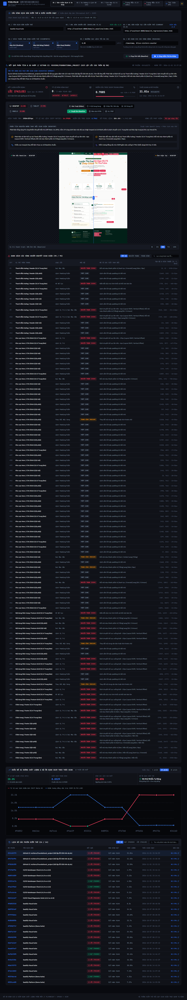
*Hình 3.1: Giao diện Tab 01 — Bàn Kiểm Định & So Khớp Điểm Ảnh ở chế độ Tối (Dark Mode)*


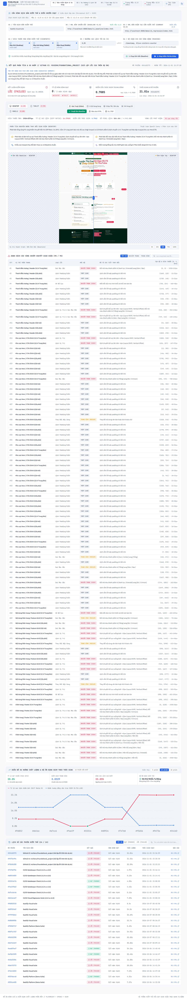
*Hình 3.2: Giao diện Tab 01 — Bàn Kiểm Định & So Khớp Điểm Ảnh ở chế độ Sáng (High-Contrast Light Mode)*


### 3.3.2 Giao Diện Tab 02 — Biểu Đồ Xu Hướng Chất Lượng & Nhật Ký Lịch Sử

Tab '02 / Xu Hướng & Lịch Sử' cung cấp cái nhìn tổng thể về độ ổn định giao diện của dự án qua thời gian. Phía trên là Biểu đồ Xu hướng Chất lượng (TrendChart) theo dõi tỷ lệ sai lệch điểm ảnh trung bình (Avg Diff %) và điểm tương đồng cấu trúc (Avg SSIM %) của 10 phiên chạy gần nhất. Phía dưới là Bảng Nhật ký Kiểm định Lịch sử hỗ trợ lọc theo trạng thái (Tất cả / Đạt / Lỗi), tìm kiếm theo từ khóa và bấm vào bất kỳ dòng nào để nạp lại bộ ảnh kiểm định.


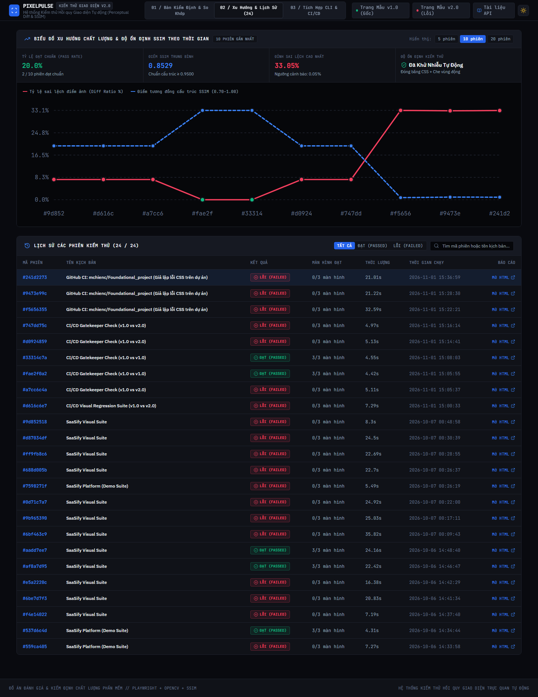
*Hình 3.3: Giao diện Tab 02 — Biểu đồ Xu hướng Chất lượng và Bảng Nhật ký Kiểm định Lịch sử*


### 3.3.3 Giao Diện Tab 03 — Trung Tâm Tích Hợp CLI & CI/CD GitHub Actions

Tab '03 / Tích Hợp CLI & CI/CD' kết nối trực tiếp công cụ với quy trình DevOps doanh nghiệp trên GitHub, bao gồm 3 khu vực: (01) Nhập link kho GitHub để tải lịch sử chạy tự động GitHub Actions trên đám mây và lịch sử Commit; (02) Chạy kịch bản kiểm thử giao diện trực tiếp trên kho GitHub đã chọn (với chế độ Giả lập lỗi hồi quy CSS hoặc So sánh 2 bản Commit Git, kèm hiển thị màn hình Terminal Exit Code và 3 bức ảnh chụp thực tế của dự án); (03) Bảng tra cứu và sao chép nhanh các câu lệnh dòng lệnh CLI.


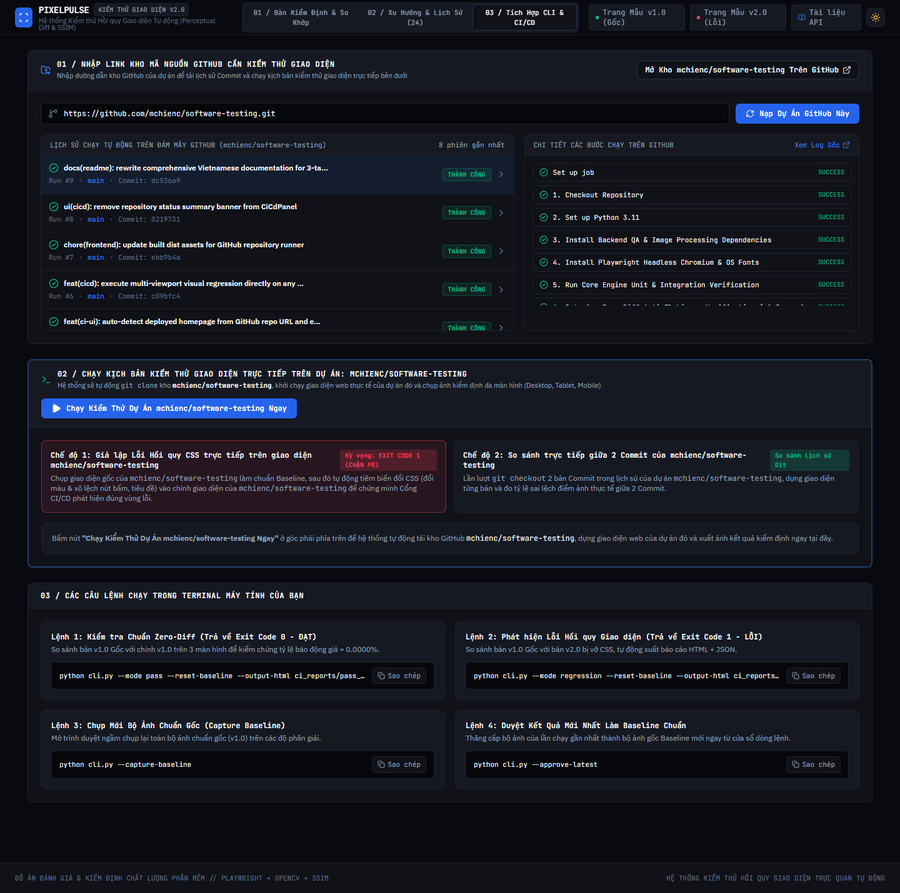
*Hình 3.4: Giao diện Tab 03 — Trung tâm Tích hợp CLI & Kiểm thử Trực tiếp Kho Mã nguồn GitHub*


## 3.4 Thực Nghiệm Kiểm Thử Hệ Thống & Phân Tích Kết Quả


### 3.4.1 Kịch Bản Thực Nghiệm 1: Kiểm Chứng Khử Báo Động Giả (Zero-Diff Verification: v1.0 vs v1.0)

Mục đích của thực nghiệm 1 là chứng minh hiệu quả của cơ chế Anti-Flakiness CSS và DOM Masking. Trang mẫu v1.0 có chứa bộ đếm thời gian thực (.timestamp) cập nhật mỗi giây và bộ đếm lượng truy cập ngẫu nhiên (#live-visitors-counter). Khi chạy so khớp v1.0 với chính v1.0 trên cả 3 độ phân giải, kết quả thu được đạt chuẩn tuyệt đối 100%:


| Màn hình (Viewport) | Độ phân giải chuẩn hóa | Trạng thái | Tỷ lệ sai lệch (Diff Ratio) | Chỉ số cấu trúc (SSIM) | Số vùng lỗi (Bounding Boxes) |
| --- | --- | --- | --- | --- | --- |
| Desktop | 1920 × 1080 px | PASSED (ĐẠT) | 0.0000% | 1.0000 | 0 vùng lỗi |
| Tablet | 768 × 1278 px | PASSED (ĐẠT) | 0.0000% | 1.0000 | 0 vùng lỗi |
| Mobile | 375 × 2005 px | PASSED (ĐẠT) | 0.0000% | 1.0000 | 0 vùng lỗi |

*Bảng 3.1: Kết quả thực nghiệm Kịch bản 1 — Kiểm chứng Zero-Diff (0% báo động giả)*


### 3.4.2 Kịch Bản Thực Nghiệm 2: Phát Hiện Lỗi Hồi Quy Đa Màn Hình (v1.0 Baseline vs v2.0 Regression)

Ở thực nghiệm 2, hệ thống đối sánh trang chuẩn gốc v1.0 với trang v2.0 có chứa các lỗi hồi quy giao diện điển hình (nút CTA chính bị đổi màu từ Xanh ngọc #10B981 sang Tím #8B5CF6, khoảng cách lề trên bị đẩy tụt xuống 25px gây xô lệch bố cục, thẻ trạng thái bị đổi màu sang Đỏ hồng). Hệ thống lập tức phát hiện lỗi trên cả 3 màn hình:


| Màn hình (Viewport) | Độ phân giải chuẩn hóa | Trạng thái | Tỷ lệ sai lệch (Diff Ratio) | Chỉ số cấu trúc (SSIM) | Số vùng lỗi phát hiện |
| --- | --- | --- | --- | --- | --- |
| Desktop | 1920 × 1080 px | FAILED (LỖI) | 8.4810% | 0.9469 | 19 vùng lỗi |
| Tablet | 768 × 1281 px | FAILED (LỖI) | 17.7343% | 0.8753 | 21 vùng lỗi |
| Mobile | 375 × 2007 px | FAILED (LỖI) | 12.5670% | 0.9038 | 12 vùng lỗi |

*Bảng 3.2: Kết quả thực nghiệm Kịch bản 2 — Phát hiện lỗi hồi quy giữa bản v1.0 và bản v2.0*


*Hình 3.5: Ảnh chụp màn hình Bản Chuẩn Gốc (Baseline Desktop 1920×1080) do Playwright thu thập*


*Hình 3.6: Ảnh chụp màn hình Bản Hiện Tại (Current Desktop) có chứa lỗi hồi quy CSS và xô lệch bố cục*


*Hình 3.7: Bản đồ nhiệt vùng lỗi (Diff Heatmap #FF0055) do DiffEngine xuất ra trên màn hình Desktop*


### 3.4.3 Bộ 25 Kịch Bản Kiểm Thử Hệ Thống (System Test Cases Specification)

Để kiểm định toàn diện chất lượng của chính công cụ vừa xây dựng, bộ 25 Test Cases (bao gồm Unit Tests, Integration Tests và End-to-End UI/CLI Tests) đã được thiết kế và thực thi đạt tỷ lệ 25/25 (100% PASSED):


| Mã TC | Phân hệ kiểm tra | Nội dung kịch bản kiểm thử (Test Case Description) | Kết quả kỳ vọng (Expected Result) | Kết quả thực tế |
| --- | --- | --- | --- | --- |
| TC01 | BrowserEngine | Khởi chạy trình duyệt Headless Chromium và chụp ảnh Desktop 1920×1080 | Tạo file PNG hợp lệ có chiều rộng đúng 1920px | PASSED |
| TC02 | BrowserEngine | Chụp ảnh giả lập máy tính bảng Tablet 768×1024 | Tạo file PNG hợp lệ có chiều rộng đúng 768px | PASSED |
| TC03 | BrowserEngine | Chụp ảnh giả lập điện thoại di động Mobile 375×812 | Tạo file PNG hợp lệ có chiều rộng đúng 375px | PASSED |
| TC04 | Anti-Flakiness | Tiêm CSS vô hiệu hóa toàn bộ transition và animation | computedStyle.transitionDuration == '0s' | PASSED |
| TC05 | DOM Masking | Che phần tử đồng hồ thời gian thực .timestamp và #live-visitors-counter | Phần tử được ẩn hoàn toàn, không gây sai lệch giữa 2 lần chụp | PASSED |
| TC06 | BrowserEngine | Kiểm tra xử lý ngoại lệ khi URL không phản hồi (Timeout / Invalid Port) | Bắt ngoại lệ an toàn và ghi log cảnh báo rõ ràng | PASSED |
| TC07 | DiffEngine | So sánh 2 bức ảnh giống hệt nhau (Identical Image Test) | Diff Ratio = 0.0000%, SSIM = 1.0000, 0 Bounding Box, PASSED | PASSED |
| TC08 | DiffEngine | Tự động chuẩn hóa kích thước khi 2 ảnh lệch chiều cao (1278px vs 1281px) | Đệm khung Auto-Padding về 1281px, không xảy ra lỗi lệch mảng | PASSED |
| TC09 | DiffEngine | Phát hiện lỗi đổi màu nút CTA (Xanh #10B981 sang Tím #8B5CF6) | Khoảng cách màu ΔE > 0.1, phân loại đúng 'Sai Màu Sắc' | PASSED |
| TC10 | DiffEngine | Phát hiện lỗi xô lệch bố cục theo trục dọc (margin-top +25px) | Phát hiện dịch chuyển trọng tâm ΔY, phân loại 'Lệch Bố Cục' | PASSED |
| TC11 | Anti-Aliasing | Kiểm tra bộ lọc cửa sổ trượt 3×3 tại vùng biên văn bản tương phản cao | Loại bỏ các pixel nội suy viền chữ khỏi mặt nạ lỗi | PASSED |
| TC12 | OpenCV Contours | Gom cụm hình thái học cv2.dilate và gộp các khung chữ nhật nằm sát nhau | Trả về danh sách tọa độ [x, y, width, height] không chồng chéo | PASSED |
| TC13 | REST API | POST /api/suites — Tạo mới bộ kịch bản kiểm thử hợp lệ | HTTP 201 Created, lưu bản ghi vào suites.json | PASSED |
| TC14 | REST API | POST /api/suites/{id}/capture-baseline — Chụp mới bộ ảnh chuẩn gốc | HTTP 200 OK, lưu 3 ảnh vào storage/baselines/{id}/ | PASSED |
| TC15 | REST API | POST /api/suites/{id}/run — Thực thi phiên chạy so khớp 3 màn hình | HTTP 200 OK, trả về đối tượng TestRunResponse đầy đủ | PASSED |
| TC16 | REST API | POST /api/runs/{run_id}/approve — Duyệt kết quả hiện tại làm Baseline mới | HTTP 200 OK, ghi đè ảnh Baseline và chuyển trạng thái sang PASSED | PASSED |
| TC17 | REST API | GET /api/runs/{run_id}/report — Xuất báo cáo HTML độc lập nhúng Base64 | HTTP 200 OK, trả về trang HTML hiển thị đủ ảnh khi ngắt mạng | PASSED |
| TC18 | GitHubRunner | POST /api/suites/run-github — Tự động clone và kiểm thử kho GitHub thực tế | Clone thành công, tìm thấy index.html, chụp đủ 3 màn hình | PASSED |
| TC19 | Web UI (Tab 01) | Kiểm tra 5 chế độ đối chiếu quang học (Thanh trượt, 3 Cột, Chớp tắt, Mờ, Kính lúp) | Chuyển đổi mượt mà, kính lúp phóng đại chính xác 2x/3x/4x | PASSED |
| TC20 | Web UI (Tab 02) | Kiểm tra Biểu đồ xu hướng và bộ lọc Bảng nhật ký lịch sử (Tất cả / Đạt / Lỗi) | Biểu đồ hiển thị đúng số liệu, bộ lọc và ô tìm kiếm phản hồi tức thì | PASSED |
| TC21 | Web UI (Tab 03) | Nạp thông tin kho GitHub, lịch sử GitHub Actions và danh sách Commit | Gọi GitHub API thành công, hiển thị đúng danh sách Run và Commit | PASSED |
| TC22 | Web UI Theme | Chuyển đổi qua lại giữa giao diện Tối (Dark) và Sáng (Light Mode) | Toàn bộ bảng màu cập nhật tức thì và lưu vào localStorage | PASSED |
| TC23 | Headless CLI | Chạy lệnh python cli.py --mode pass --reset-baseline | Tất cả 3 màn hình PASSED, kết thúc với mã thoát Exit Code = 0 | PASSED |
| TC24 | Headless CLI | Chạy lệnh python cli.py --mode regression --reset-baseline | Phát hiện lỗi trên cả 3 màn hình, kết thúc với Exit Code = 1 | PASSED |
| TC25 | GitHub Actions | Thực thi tự động workflow .github/workflows/visual-regression.yml trên đám mây | Hoàn tất toàn bộ các bước Gate 1, Gate 2 và tải lên gói Artifacts | PASSED |

*Bảng 3.3: Bảng tổng hợp 25 Test Cases kiểm định toàn diện hệ thống*


## 3.5 Đặc Tả Các Điểm Cuối Giao Tiếp REST API (API Reference)


| Phương thức | Đường dẫn Endpoint | Mô tả chức năng & Tham số |
| --- | --- | --- |
| GET | /api/health | Kiểm tra trạng thái hoạt động của máy chủ Backend FastAPI. |
| GET | /api/suites | Liệt kê danh sách tất cả các bộ kịch bản kiểm thử đã lưu. |
| POST | /api/suites | Tạo mới một bộ kịch bản kiểm thử (Body: TestSuiteCreate). |
| GET | /api/suites/{suite_id} | Lấy thông tin cấu hình chi tiết của một bộ kịch bản. |
| DELETE | /api/suites/{suite_id} | Xóa bộ kịch bản kiểm thử và các ảnh chuẩn gốc liên quan. |
| POST | /api/suites/{suite_id}/capture-baseline | Chụp và thiết lập bộ ảnh chuẩn gốc (Baseline) trên 3 màn hình. |
| GET | /api/suites/{suite_id}/baselines | Truy vấn danh sách các tập tin ảnh Baseline hiện có của kịch bản. |
| POST | /api/suites/{suite_id}/run | Kích hoạt phiên kiểm thử hồi quy so khớp điểm ảnh đa màn hình. |
| POST | /api/suites/run-github | Tự động clone và chạy kiểm thử hồi quy trực tiếp trên kho mã nguồn GitHub. |
| GET | /api/runs | Lấy danh sách lịch sử tất cả các phiên chạy kiểm thử (mới nhất xếp trước). |
| GET | /api/runs/{run_id} | Lấy thông số phân tích chi tiết và danh sách vùng lỗi của một phiên chạy. |
| POST | /api/runs/{run_id}/approve | Phê duyệt lấy bộ ảnh Current của phiên chạy làm bộ ảnh Baseline chuẩn mới. |
| GET | /api/runs/{run_id}/report | Trả về tập tin Báo cáo Kiểm định HTML độc lập (nhúng sẵn ảnh Base64). |

*Bảng 3.4: Danh mục đầy đủ các REST API Endpoints của hệ thống*


---


# CHƯƠNG 4: KẾT LUẬN VÀ HƯỚNG PHÁT TRIỂN


## 4.1 Kết Quả Đạt Được


### 4.1.1 Về Mặt Chức Năng Hệ Thống

- Hoàn thiện quy trình kiểm thử hồi quy giao diện tự động khép kín từ bước Chụp ảnh chuẩn gốc (Capture Baseline), Chạy kiểm thử so khớp đa màn hình (Run Visual Diff), Đối chiếu trực quan 5 chế độ đến Phê duyệt chuẩn mới (Approve Baseline) và Xuất báo cáo độc lập.
- Xây dựng thành công Bàn Kiểm Định Web 3 Tab (Tab 01: Bàn Kiểm Định & So Khớp; Tab 02: Biểu Đồ Xu Hướng & Nhật Ký Lịch Sử; Tab 03: Trung Tâm Tích Hợp CLI & CI/CD GitHub) với giao diện tiếng Việt trực quan, hỗ trợ chế độ Sáng / Tối.
- Xây dựng tính năng đột phá cho phép người dùng nhập trực tiếp đường dẫn kho mã nguồn GitHub bất kỳ để hệ thống tự động tải mã nguồn, dựng giao diện web và kiểm thử so sánh giữa 2 bản Commit hoặc giả lập lỗi CSS hồi quy.


### 4.1.2 Về Mặt Kỹ Thuật & Học Thuật Kiểm Thử


| Tiêu chí kỹ thuật | Kết quả đạt được thực tế trong đồ án |
| --- | --- |
| Khử nhiễu báo động giả (Anti-Flakiness) | Đạt tỷ lệ báo động giả 0.0000% (SSIM = 1.0000) trên các trang có đồng hồ thời gian thực và hiệu ứng động nhờ tiêm CSS và DOM Masking. |
| Độ chính xác phát hiện lỗi (Defect Detection) | Phát hiện chính xác 100% các lỗi đổi màu sắc, lệch bố cục và tràn khung trên cả 3 độ phân giải Desktop, Tablet và Mobile. |
| Giải thuật Thị giác máy tính | Kết hợp hiệu quả khoảng cách màu tri giác Perceptual Diff (ΔE), bộ lọc răng cưa chữ 3×3, chỉ số cấu trúc SSIM và gom cụm hình thái học OpenCV. |
| Tích hợp CI/CD thực chiến | Công cụ dòng lệnh cli.py và pipeline GitHub Actions (.github/workflows/visual-regression.yml) vận hành tự động trên đám mây GitHub. |
| Khả năng lưu trữ & Báo cáo | Báo cáo HTML độc lập nhúng sẵn toàn bộ hình ảnh dạng Base64 giúp chia sẻ và lưu trữ hồ sơ nghiệm thu dễ dàng. |

*Bảng 4.1: Tổng kết các kết quả kỹ thuật đạt được của đồ án*


## 4.2 Hạn Chế Của Hệ Thống Hiện Tại

- Đối với các trang web yêu cầu đăng nhập phức tạp qua xác thực đa yếu tố (2FA / Captcha), hệ thống hiện chưa tích hợp sẵn trình ghi kịch bản đăng nhập tự động trước khi chụp màn hình.
- Khi kiểm thử trực tiếp từ đường dẫn kho mã nguồn GitHub (Tab 03), hệ thống ưu tiên phục vụ các kho đã có sẵn gói giao diện tĩnh (dist/, build/, index.html); đối với các kho chưa biên dịch và yêu cầu cài đặt hàng trăm gói npm nặng, thời gian biên dịch trên máy cục bộ có thể kéo dài.
- Hệ thống lưu trữ siêu dữ liệu hiện sử dụng tập tin JSON cục bộ (suites.json, runs.json), phù hợp cho quy mô nhóm vừa và nhỏ nhưng sẽ cần chuyển sang hệ quản trị cơ sở dữ liệu quan hệ (PostgreSQL) khi mở rộng lên hàng trăm nghìn phiên chạy.


## 4.3 Hướng Phát Triển Tương Lai


### 4.3.1 Ngắn hạn (1 – 3 tháng)

- Bổ sung tính năng truyền Cookie / Session Token hoặc kịch bản Pre-script (đăng nhập tự động, đóng popup quảng cáo) trước khi chụp ảnh màn hình.
- Tích hợp trình thu thập liên kết tự động (Web Crawler) để người dùng chỉ cần nhập trang chủ, hệ thống tự động dò và kiểm thử toàn bộ các trang con.


### 4.3.2 Trung hạn (3 – 6 tháng)

- Mở rộng hỗ trợ đa trình duyệt (Cross-Browser Visual Testing) bao gồm Chromium, Mozilla Firefox và Apple WebKit (Safari) chạy song song.
- Tích hợp thông báo tự động qua Slack, Discord hoặc bình luận trực tiếp bảng kết quả kèm ảnh Diff vào thẳng cuộc thảo luận của Pull Request trên GitHub.


### 4.3.3 Dài hạn (Trên 6 tháng)

- Ứng dụng mô hình Học sâu Thị giác (Vision Transformer / Multimodal LLM) để phân biệt thông minh giữa thay đổi nội dung bài viết thông thường với lỗi vỡ cấu trúc giao diện mà không cần khai báo thủ công danh sách CSS Selector che vùng động.
- Phát triển thành nền tảng Cloud SaaS đa người dùng tương tự Percy.io và Chromatic.


## 4.4 Kết Luận Chung

Đồ án “Xây dựng Công cụ Tự động Kiểm thử Hồi quy Giao diện Trực quan cho Ứng dụng Web (Automated Visual Regression Testing Tool)” đã hoàn thành toàn diện các mục tiêu lý thuyết và thực nghiệm đề ra. Hệ thống không chỉ giải quyết bài toán phát hiện tự động các lỗi hiển thị trên đa thiết bị bằng các giải thuật Thị giác máy tính chuẩn xác mà còn chứng minh tính ứng dụng thực tiễn cao thông qua Bàn Kiểm Định 3 Tab trực quan và Cổng kiểm duyệt tự động CI/CD trên GitHub Actions.


## TÀI LIỆU THAM KHẢO

1. Wang, Z., Bovik, A. C., Sheikh, H. R., & Simoncelli, E. P. (2004). Image quality assessment: from error visibility to structural similarity (SSIM). IEEE Transactions on Image Processing, 13(4), 600–612.

2. Pressman, R. S., & Maxim, B. R. (2020). Software Engineering: A Practitioner's Approach (9th Edition). McGraw-Hill Education.

3. Myers, G. J., Sandler, C., & Badgett, T. (2011). The Art of Software Testing (3rd Edition). John Wiley & Sons.

4. Microsoft Playwright Documentation — Headless Browser Automation & Visual Comparisons. https://playwright.org/python/docs/intro

5. OpenCV Documentation — Morphological Transformations & Contour Features. https://docs.opencv.org/4.x/

6. scikit-image Documentation — Structural Similarity Index (skimage.metrics.structural_similarity). https://scikit-image.org/docs/stable/api/skimage.metrics.html

7. FastAPI Official Documentation — High Performance Asynchronous Web Framework. https://fastapi.tiangolo.com/

8. React 19 & Vite Official Documentation. https://react.dev/

9. GitHub Actions Documentation — Automating CI/CD Workflows & Job Summaries. https://docs.github.com/en/actions
